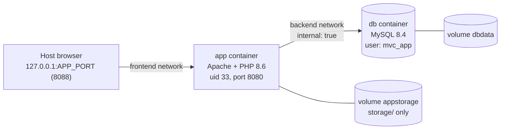
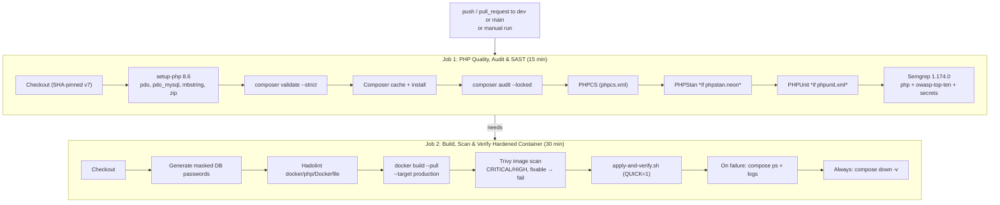

# MVC_PHP — Custom PHP MVC Application

[](https://github.com/milanrohit/MVC_PHP/actions/workflows/ci.yml)


Operational documentation for a custom PHP MVC application that runs in two independent local environments: Docker Desktop (Docker Compose) and XAMPP, with a DevSecOps CI pipeline on GitHub Actions. Docker and XAMPP instructions are parallel so the same task can be found in both. Values that the repository does not confirm are written as placeholders and listed in [section 20](#20-verification-and-assumptions).

> **New here?** Read [1. Project overview](#1-project-overview) → [6.5 First run](#65-first-run-safe-order) → [13. Quality and CI](#13-quality-and-ci). To see what changed and why, read [17. How this project was built](#17-how-this-project-was-built-engineering-standards) and the [18. Changelog](#18-changelog). To record your own change, follow [19. Adding a future update](#19-adding-a-future-update).

## Evidence legend

| Tag             | Meaning                                                                                                         |
| :-------------- | :-------------------------------------------------------------------------------------------------------------- |
| `[CONFIRMED]`   | Observed in a repository file, a command output from this project, a CI run, or a file supplied for this README |
| `[UNVERIFIED]`  | Not inspected. A verification command is given next to it                                                       |
| `[GAP]`         | A control or capability that is absent or not implemented. See the gap register in section 20                   |
| `<PLACEHOLDER>` | A value the repository does not confirm. Replace it after running the stated verification                       |

Shell labels. Every command block names its shell. _Git Bash / POSIX_ blocks use single quotes and `$VAR`, and are not valid unchanged in PowerShell or Command Prompt. The Docker commands in this README are written for Git Bash / POSIX because that is the shell used on this project; PowerShell or `cmd` variants are shown only where the syntax differs.

> **Git Bash on Windows:** run `export MSYS_NO_PATHCONV=1` once per Git Bash window before any `docker run -v ...` command in this README, and use `"$(pwd -W)"` for the current folder. Without it, Git Bash rewrites container paths such as `/app` into Windows paths. `[CONFIRMED]`

## Table of contents

1. [Project overview](#1-project-overview)
2. [Architecture](#2-architecture)
3. [Compatibility matrix](#3-compatibility-matrix)
4. [Environment isolation](#4-environment-isolation)
5. [Port management](#5-port-management)
6. [Docker Desktop setup](#6-docker-desktop-setup)
7. [XAMPP setup](#7-xampp-setup)
8. [Configuration reference](#8-configuration-reference)
9. [Database and assets](#9-database-and-assets)
10. [Daily development workflow](#10-daily-development-workflow)
11. [Validation](#11-validation)
12. [Security](#12-security)
13. [Quality and CI](#13-quality-and-ci)
14. [Upgrades and lifecycle](#14-upgrades-and-lifecycle)
15. [Troubleshooting](#15-troubleshooting)
16. [Release and rollback](#16-release-and-rollback)
17. [How this project was built (engineering standards)](#17-how-this-project-was-built-engineering-standards)
18. [Changelog](#18-changelog)
19. [Adding a future update](#19-adding-a-future-update)
20. [Verification and assumptions](#20-verification-and-assumptions)

---

## 1. Project overview

- A custom PHP MVC application with a public frontend context and a backend (admin) context. Business logic and data access are shared. `[CONFIRMED: app/ tree]`
- Reference domain: e-commerce. The migrations create users, categories, products, orders and order details. `[CONFIRMED: database/migrations/]`
- Framework core in `core/` (container, router, request/response, session, CSRF, view, database, migrator, env loader). `[CONFIRMED: core/ tree]`
- Runtime: **PHP 8.6** on `php:8.6-apache` (Debian 13 "trixie", thread-safe/ZTS build), **MySQL 8.4**. `[CONFIRMED: CI build log, Trivy report]`
- Frontend build pipeline: Vite with Vue single-file components (`resources/js/components/Counter.vue`) and CSS (`resources/css/app.css`), output in `public/build/`. Scripts, versions and ports are `[UNVERIFIED]` (see section 9.3).
- Containerised runtime: one multi-stage Dockerfile (`docker/php/Dockerfile`: `base` → `vendor` → `production`) and Compose files using the current [Compose Specification](https://docs.docker.com/reference/compose-file/) with no `version:` key. The app runs as non-root (uid 33) on port 8080 with read-only code. `[CONFIRMED]`
- **DevSecOps CI** (`.github/workflows/ci.yml`): Composer validate/audit, PHPCS (PSR-12), PHPStan/PHPUnit (when configured), Semgrep SAST, Hadolint, Docker build, Trivy image scan and an automated hardening verification. First fully green run: **#22**, commit `309d342`, 27 Nov 2026. `[CONFIRMED]`
- The same repository can also run under XAMPP. XAMPP does not use Docker in any way.

---

## 2. Architecture

### 2.1 Request flow

```text
Browser -> Apache (document root: public/, port 8080 in the container)
        -> public/index.php            front controller
        -> Core\Application            container + configuration load
        -> Core\Router (routes/web.php)
        -> middleware                  CsrfMiddleware, SecurityHeaders
        -> controller                  app/Frontend/Controllers or app/Backend/Controllers
        -> service -> repository       app/Services -> app/Repositories (PDO via core/Database.php)
        -> view                        app/<Context>/Views (output escaped with e())
        -> Core\Response
```

`[CONFIRMED]` component names and folders. `[UNVERIFIED]` the exact order and which middleware is registered on which route. Verify in `public/index.php`, `core/Application.php`, `core/Router.php` and `routes/web.php`.

### 2.2 Runtime topology (Docker)



The `backend` network is `internal: true`: the database has no route to the internet and is reachable only by containers on that network. `[CONFIRMED: docker-compose.yml]`

### 2.3 Layers and boundaries

| Layer                          | Path                                              | Rule                                                                                                                  |
| :----------------------------- | :------------------------------------------------ | :-------------------------------------------------------------------------------------------------------------------- |
| Core engine                    | `core/`                                           | No application logic; no dependency on `app/`                                                                         |
| Contexts                       | `app/Frontend/`, `app/Backend/`                   | Each owns `Controllers/`, `Models/`, `Views/` (`home/`, `layouts/`). The public and admin contexts do not share views |
| Middleware                     | `app/Middleware/`                                 | Cross-cutting request/response concerns                                                                               |
| Services                       | `app/Services/`                                   | Business logic shared by both contexts                                                                                |
| Repositories                   | `app/Repositories/` (+ `Contracts/`)              | The only layer that talks to the database                                                                             |
| Shared models                  | `app/Models/`                                     | Models used by both contexts                                                                                          |
| Helpers / Support / Exceptions | `app/Helpers/`, `app/Support/`, `app/Exceptions/` | Static utilities, seeding/validation support, typed exceptions                                                        |
| Config                         | `config/`                                         | `app.php`, `database.php`                                                                                             |
| Database                       | `database/migrate.php`, `database/migrations/`    | Numbered SQL migrations                                                                                               |
| Public web root                | `public/`                                         | The only directory Apache serves                                                                                      |
| Writable state                 | `storage/logs/`                                   | The only runtime-writable path in the hardened image                                                                  |

### 2.4 Adding a feature

1. Add the route in `routes/web.php` and attach the needed middleware.
2. Add a controller in the correct context. Controllers stay thin.
3. Put business rules in a service; put SQL only in a repository (define the interface in `Repositories/Contracts/`).
4. Add or reuse a model; add a numbered migration in `database/migrations/` for schema changes.
5. Render through the context's view; escape every dynamic value with `e()`.
6. Never query the database from a view, and never let a frontend controller call a backend class.
7. Run the local quality checks (section 13.3) before committing; CI runs the same checks.

### 2.5 Verified directory tree

Source: the `tree` output supplied for this project, a directory listing of the built image, and files changed during the November 2026 DevSecOps work.

```text
MVC_PHP/
├── .github/
│   ├── workflows/ci.yml            # DevSecOps pipeline (section 13) [CONFIRMED]
│   └── dependabot.yml              # weekly updates: actions, composer, docker [UNVERIFIED: committed?]
├── .vscode/
├── .dockerignore                   # cleaned and grouped (section 6.3)
├── .env.example                    # DB_USERNAME=mvc_app, DB_PASSWORD, DB_ROOT_PASSWORD
├── .gitattributes                  # LF endings for *.sh, *.yml, Dockerfile [UNVERIFIED]
├── .gitignore
├── .hadolint.yaml                  # Hadolint config used by CI [CONFIRMED]
├── app/
│   ├── Backend/{Controllers,Models,Views}/       # Views: home/, layouts/
│   ├── Frontend/{Controllers,Models,Views}/
│   ├── Exceptions/                 # AppException + typed subclasses
│   ├── Helpers/                    # Array, Constant, Debug, Sql, String, Validator helpers
│   ├── Middleware/                 # CsrfMiddleware, SecurityHeaders
│   ├── Models/                     # User
│   ├── Repositories/               # UserRepository, Contracts/UserRepositoryInterface
│   ├── Services/                   # UserService
│   └── Support/                    # DatabaseSeeder, Validator
├── config/                         # app.php, database.php
├── core/                           # Application, Config, Container, Controller, Csrf, Database, Env,
│                                   # ExceptionHandler, HttpException, MiddlewareInterface, Migrator,
│                                   # Request, Response, Router, Session, View, helpers.php
├── database/
│   ├── migrate.php
│   └── migrations/                 # 000_create_db ... 005_create_order_detail (.sql)
├── docker/
│   ├── apache/                     # vhost.conf, security.conf, custom_dev.ini (dev only)
│   ├── php/                        # Dockerfile (authoritative), opcache.ini, security_php2shell.ini
│   └── tools/Dockerfile            # tooling container image
├── public/                         # index.php, build/ (+ .htaccess: UNVERIFIED)
├── resources/                      # css/app.css, js/{app.js,bridge.js,components/Counter.vue}
├── routes/web.php
├── storage/logs/                   # app.log, php-error.log
├── apply-and-verify.sh             # hardening verification (also run by CI)
├── composer.json, composer.lock
├── docker-compose.yml              # hardened base (app, db, networks frontend/backend)
├── docker-compose.override.yml     # development (auto-loaded)
├── docker-compose.tools.yml        # tooling project "mvc_tools"
├── Dockerfile                      # legacy copy, kept in sync manually [GAP G-9]
├── package.json, vite.config.js    # no package-lock.json in the supplied tree [GAP G-4]
├── phpcs.xml, sonar-project.properties
└── runseeder.php
```

Not part of the application (local artefacts: `build.log`, `phpinfo.txt`, `phpcs-report.txt`, `project_structure*.txt`, `MVC_INFO.txt`, `github_readme.md`, `.phpcs.cache`). Keep them out of git and out of the image; `.dockerignore` excludes them. `phpinfo.txt` dumps server configuration and must not be committed.

Root `.htaccess`: not present in the directory listing of the built image `[CONFIRMED absent in that listing]`. Both environments must use `public/` as the document root. Whether `public/.htaccess` exists is `[UNVERIFIED]` (`ls -la public`).

### 2.6 PSR-4 mapping

`[UNVERIFIED]` against `composer.json`. Verify with: `sed -n '/"autoload"/,/}/p' composer.json`.

| Directory                                                                      | Namespace                                                                      |
| :----------------------------------------------------------------------------- | :----------------------------------------------------------------------------- |
| `app/Backend/Controllers`, `app/Frontend/Controllers`                          | `App\Backend\Controllers`, `App\Frontend\Controllers`                          |
| `app/Backend/Models`, `app/Frontend/Models`                                    | `App\Backend\Models`, `App\Frontend\Models`                                    |
| `app/Exceptions`, `app/Helpers`, `app/Middleware`, `app/Models`, `app/Support` | `App\Exceptions`, `App\Helpers`, `App\Middleware`, `App\Models`, `App\Support` |
| `app/Repositories`, `app/Repositories/Contracts`                               | `App\Repositories`, `App\Repositories\Contracts`                               |
| `app/Services`                                                                 | `App\Services`                                                                 |
| `core`                                                                         | `Core`                                                                         |

---

## 3. Compatibility matrix

Every row names its source. Replace placeholders only after running the verification command.

| Component                  | Value                                                                                             | Source                                                 | Pinned?                   | Needed for         | Verify locally                                              |
| :------------------------- | :------------------------------------------------------------------------------------------------ | :----------------------------------------------------- | :------------------------ | :----------------- | :---------------------------------------------------------- |
| PHP (Docker)               | **8.6** (`ARG PHP_VERSION=8.6`), ZTS build, API `20261112`                                        | `docker/php/Dockerfile`; CI build log `[CONFIRMED]`    | Minor tag                 | Dev and production | `docker compose exec app php -v`                            |
| Base OS (Docker)           | Debian 13.8 "trixie"                                                                              | Trivy report, CI run #21 `[CONFIRMED]`                 | Via image                 | Docker             | `docker compose exec app cat /etc/debian_version`           |
| PHP (XAMPP)                | `<XAMPP_PHP_VERSION>` (bundled with XAMPP)                                                        | XAMPP install                                          | Not pinned                | Dev only           | `<XAMPP_DIR>\php\php.exe -v`                                |
| PHP constraint             | `^8.6` with `config.platform.php = 8.6.0`                                                         | `composer.json` (set Nov 2026) `[UNVERIFIED: re-read]` | Range                     | Both               | `grep -n '"php"' composer.json`                             |
| Apache                     | Whatever `php:8.6-apache` ships (2.4.x on Debian)                                                 | Base image                                             | Via image                 | Docker             | `docker compose exec app apache2 -v`                        |
| Apache (XAMPP)             | `<XAMPP_APACHE_VERSION>`                                                                          | XAMPP install                                          | Not pinned                | XAMPP              | `<XAMPP_DIR>\apache\bin\httpd.exe -v`                       |
| Composer (Docker build)    | `composer:2` image                                                                                | `docker/php/Dockerfile` vendor stage                   | Major only                | Build              | `docker run --rm composer:2 --version`                      |
| Composer (tooling / host)  | `<COMPOSER_VERSION>`                                                                              | `docker/tools/Dockerfile` `[UNVERIFIED]` / host        | Not pinned                | Dev                | `composer --version`                                        |
| PHP_CodeSniffer / Slevomat | 3.13.6 / 8.22.1                                                                                   | `composer.lock` (install output) `[CONFIRMED]`         | Locked                    | QA                 | `vendor/bin/phpcs --version`                                |
| PHPUnit                    | 12.5.45 (installed, no config yet)                                                                | `composer.lock` `[CONFIRMED]`                          | Locked                    | QA                 | `vendor/bin/phpunit --version`                              |
| Semgrep                    | 1.174.0 (`semgrep/semgrep` image)                                                                 | `ci.yml` `SEMGREP_IMAGE` `[CONFIRMED]`                 | Exact                     | CI                 | `docker run --rm semgrep/semgrep:1.174.0 semgrep --version` |
| Hadolint                   | `hadolint/hadolint-action` v3.5.0 (SHA-pinned)                                                    | `ci.yml` `[CONFIRMED]`                                 | SHA                       | CI                 | `docker run --rm hadolint/hadolint --version`               |
| Trivy                      | 0.70.0 via `aquasecurity/trivy-action` v0.36.0 (SHA-pinned); 0.76.2 available                     | CI log `[CONFIRMED]`                                   | SHA                       | CI                 | `docker run --rm aquasec/trivy --version`                   |
| Node.js / npm              | `<NODE_VERSION>` / `<NPM_VERSION>`                                                                | `package.json` `engines`, `.nvmrc` `[UNVERIFIED]`      | Unknown                   | Frontend build     | `node -v`; `npm -v`                                         |
| Vite / Vue / CSS toolchain | `<VITE_VERSION>`                                                                                  | `package.json`                                         | Range                     | Frontend build     | `npm ls vite vue`                                           |
| Database (Docker)          | MySQL `8.4`                                                                                       | `docker-compose.yml` (`mysql:8.4`)                     | Minor tag, not digest     | Dev                | `docker compose exec db mysql --version`                    |
| Database (XAMPP)           | MariaDB/MySQL `<MARIADB_VERSION>` (bundled)                                                       | XAMPP install                                          | Not pinned                | XAMPP              | `<XAMPP_DIR>\mysql\bin\mysql.exe --version`                 |
| PHP extensions (Docker)    | `pdo_mysql`, `zip`, `mbstring` (installed by `install-php-extensions`); `sodium`, OPcache present | `docker/php/Dockerfile`; build log `[CONFIRMED]`       | Via image                 | Docker             | `docker compose exec app php -m`                            |
| Required extensions (all)  | `ext-pdo`, `ext-mbstring` (+ platform reqs)                                                       | `composer.json` `[UNVERIFIED: re-read]`                | Range                     | Both               | `composer check-platform-reqs`                              |
| Docker Desktop             | `<DOCKER_DESKTOP_VERSION>`                                                                        | Developer machine                                      | Not pinned                | Docker             | `docker version`                                            |
| Compose                    | v2 plugin, 2.24 or newer (the override uses the `!override` tag)                                  | `docker-compose.override.yml`                          | Minimum                   | Docker             | `docker compose version`                                    |
| phpMyAdmin                 | `phpmyadmin:5.2`                                                                                  | `docker-compose.override.yml`                          | Minor tag, tag unverified | Dev only           | `docker manifest inspect phpmyadmin:5.2`                    |

Engine difference: Docker uses MySQL 8.4; XAMPP ships MariaDB (or MySQL, depending on the XAMPP build). The migrations must run on both. Compatibility is `[UNVERIFIED]`; run the migrations in each environment and compare the resulting tables.

---

## 4. Environment isolation

### 4.1 Supported isolation model: two working copies

The application loads its settings from real environment variables first and from a `.env` file second `[CONFIRMED: core/Env.php::get]`. In the Docker development stack the whole project folder is bind-mounted into the container, so anything in the folder is visible to the container. The only way to keep the two environments from contaminating each other without changing code is to give each its own folder:

```text
<DOCKER_WORKDIR>   e.g. C:\project\MVC_PHP              <- Docker Desktop only
<XAMPP_WORKDIR>    e.g. C:\projects\mvc_php_xampp       <- XAMPP only
```

```bash
# Git Bash / POSIX - run once from the parent folder
git clone https://github.com/milanrohit/MVC_PHP.git MVC_PHP
git clone https://github.com/milanrohit/MVC_PHP.git mvc_php_xampp
```

| State                             | Docker working copy                                                                             | XAMPP working copy                                       |
| :-------------------------------- | :---------------------------------------------------------------------------------------------- | :------------------------------------------------------- |
| `.env`                            | Own file (Compose variables)                                                                    | Own file (application variables)                         |
| `vendor/`                         | Own (see 6.6)                                                                                   | Own (host Composer, XAMPP PHP)                           |
| `node_modules/`                   | Own (see 6.6)                                                                                   | Own (Windows npm)                                        |
| `public/build/`                   | Own                                                                                             | Own                                                      |
| `storage/` (logs, cache, uploads) | Own                                                                                             | Own                                                      |
| Database engine and data          | Docker volume `<COMPOSE_PROJECT>_dbdata` (MySQL 8.4)                                            | `<XAMPP_DIR>\mysql\data`                                 |
| Containers, networks, volumes     | Docker project (section 6.2)                                                                    | None                                                     |
| Package download caches           | Docker: `composer-cache` volume (tooling project), `mvc_vendor` volume (local QA, section 13.3) | Host Composer/npm caches (downloads only; safe to share) |

Different folder names give different Compose project names, so the two Docker-side resources never collide, and nothing in the XAMPP copy is read by a container.

### 4.2 Single working copy (fallback, weaker isolation)

If you keep one folder, these items are shared and can contaminate each other: `.env`, `vendor/`, `node_modules/`, `public/build/`, `storage/`. `[GAP G-1]`

- Use `.env.docker` for Compose only: always run `docker compose --env-file .env.docker ...`. This keeps Compose from reading the XAMPP `.env`.
- Keep the XAMPP values in `.env` (the filename the application loader reads; verify the path in `core/Env.php`).
- The Docker development container still sees the XAMPP `.env` through the bind mount. Because real environment variables win, only keys that Compose does not set (anything other than `DB_HOST`, `DB_PORT`, `DB_DATABASE`, `DB_USERNAME`, `DB_PASSWORD`) can leak from it.
- `vendor/` and `node_modules/` created by one runtime may not work in the other. Delete and reinstall them when you switch (section 15).
- `apply-and-verify.sh` reads `.env` locally `[GAP G-3]`; in CI it uses exported variables.

### 4.3 Environment files

| File                        | Used by                                                                            | Location           | Contents                                                                                                                                    | Committed |
| :-------------------------- | :--------------------------------------------------------------------------------- | :----------------- | :------------------------------------------------------------------------------------------------------------------------------------------ | :-------- |
| `.env.example`              | Template                                                                           | Repository         | `DB_ROOT_PASSWORD=`, `DB_USERNAME=mvc_app`, `DB_PASSWORD=`, optional ports                                                                  | Yes       |
| `.env` (Docker copy)        | Compose variable interpolation; also read by the app through the bind mount in dev | `<DOCKER_WORKDIR>` | **Required:** `DB_ROOT_PASSWORD`, `DB_PASSWORD`. Optional: `APP_PORT`, `DB_DATABASE`, `DB_USERNAME` (must not be `root`), `DB_FORWARD_PORT` | No        |
| `.env` (XAMPP copy)         | Application loader                                                                 | `<XAMPP_WORKDIR>`  | `DB_HOST=127.0.0.1`, `DB_PORT`, `DB_DATABASE`, `DB_USERNAME`, `DB_PASSWORD`, application keys                                               | No        |
| `.env.docker`, `.env.xampp` | Fallback names for single-copy mode only                                           | Project root       | As above                                                                                                                                    | No        |

Confirm they are ignored: `git check-ignore -v .env .env.docker .env.xampp` (each must print a rule).

### 4.4 Precedence (highest wins)

| #   | Source                                                                                                                                                    | Applies to                                                                          |
| :-- | :-------------------------------------------------------------------------------------------------------------------------------------------------------- | :---------------------------------------------------------------------------------- |
| 1   | Real process environment inside the app container or the PHP process (`getenv`). In Docker these are the `environment:` entries of the `app` service      | Application at runtime `[CONFIRMED: core/Env.php]`. An empty string counts as unset |
| 2   | `.env` file read by `core/Env.php`                                                                                                                        | Application fallback only                                                           |
| 3   | Defaults in `config/*.php` (`DB_DATABASE` → `mvc_app`, `DB_PORT` → `3306`, `DB_HOST` → `db` inside Docker or `127.0.0.1` outside, `DB_USERNAME` → `root`) | Application `[CONFIRMED: config/database.php]`                                      |

For Compose values: variables exported in the shell running `docker compose` override the env file, which overrides `${VAR:-default}` defaults in the Compose file. In Docker, Compose always sets `DB_USERNAME` (default `mvc_app`), so the `root` fallback in `config/database.php` only applies outside Docker. Print the resolved result with the redaction command in section 6.1 before starting anything.

### 4.5 Switching environments safely

- Two working copies: nothing to switch. Stop whichever environment holds a port you need (section 5.4).
- Single working copy:
  1. Stop the running environment (`docker compose down`, or stop Apache and MySQL in the XAMPP Control Panel).
  2. Select that environment's env file (`--env-file .env.docker` for Docker; `.env` for XAMPP).
  3. Confirm the active database host and name with the isolation tests below.
  4. Never copy Docker database files into the XAMPP `data` folder, and never point two engines at one data directory. Use SQL dumps to move data.

### 4.6 Isolation tests (no secrets printed)

Docker (Git Bash / POSIX)

```bash
docker compose exec app sh -c 'echo "in-docker=$(test -f /.dockerenv && echo yes || echo no) DB_HOST=$DB_HOST DB_PORT=$DB_PORT DB_DATABASE=$DB_DATABASE DB_USERNAME=$DB_USERNAME"; php -v | head -n 1'
```

Expected: `in-docker=yes`, `DB_HOST=db`, `DB_PORT=3306`, `DB_USERNAME=mvc_app`, `PHP 8.6.x`.

XAMPP (Command Prompt, from `<XAMPP_WORKDIR>`)

```bat
findstr /B /C:"DB_HOST" /C:"DB_PORT" /C:"DB_DATABASE" .env
where php
php -v
```

Expected: `DB_HOST=127.0.0.1`, the XAMPP port, and a `php` path inside `<XAMPP_DIR>`. Nothing printed contains a password.

Both: the two web URLs answer on different ports (section 5), and `docker volume ls --filter label=com.docker.compose.project=<COMPOSE_PROJECT>` lists only Docker resources while `<XAMPP_DIR>\mysql\data` contains only XAMPP databases.

---

## 5. Port management

### 5.1 Port register

| Port                       | Side              | Environment                | Value                                                    | Defined in                                                                                             | Reachable from                     | Status                                                                                      |
| :------------------------- | :---------------- | :------------------------- | :------------------------------------------------------- | :----------------------------------------------------------------------------------------------------- | :--------------------------------- | :------------------------------------------------------------------------------------------ |
| Apache listener            | Container         | Docker                     | `8080`                                                   | `docker/php/Dockerfile` (production stage rewrites `Listen` and the VirtualHost) and its `HEALTHCHECK` | Inside the container networks only | `[CONFIRMED]`                                                                               |
| App host port              | Host              | Docker                     | `127.0.0.1:${APP_PORT:-8088}` mapped to container `8080` | `docker-compose.yml`                                                                                   | The host machine only (loopback)   | Default `8088` `[CONFIRMED]`; CI uses `APP_PORT=8088`                                       |
| MySQL listener             | Container         | Docker                     | `3306`                                                   | `mysql:8.4` image                                                                                      | `backend` network only (internal)  | `[CONFIRMED]`                                                                               |
| MySQL host port            | Host              | Docker (dev override only) | `127.0.0.1:${DB_FORWARD_PORT:-3309}` mapped to `3306`    | `docker-compose.override.yml`                                                                          | Host loopback                      | Default `3309`. **May not publish while `db` is only on the internal network** `[GAP G-16]` |
| phpMyAdmin listener / host | Container / Host  | Docker (dev override only) | `80` / `127.0.0.1:8084`                                  | `docker-compose.override.yml`                                                                          | Host loopback                      | Hard-coded `[GAP G-6]`; needs the `backend` network `[GAP G-16]`                            |
| Vite dev server            | Host or container | Either                     | `<VITE_PORT>`                                            | `vite.config.js`                                                                                       | `[UNVERIFIED]`                     | Read `vite.config.js` `server.port`                                                         |
| XAMPP Apache               | Host              | XAMPP                      | `<XAMPP_HTTP_PORT>` (XAMPP default is `80`)              | `<XAMPP_DIR>\apache\conf\httpd.conf` (`Listen`)                                                        | Host                               | XAMPP default, not a project fact                                                           |
| XAMPP MySQL / MariaDB      | Host              | XAMPP                      | `<XAMPP_MYSQL_PORT>` (XAMPP default is `3306`)           | `<XAMPP_DIR>\mysql\bin\my.ini` (`port=`)                                                               | Host                               | XAMPP default, not a project fact                                                           |

Docker uses `8088` and `3309` so it does not fight XAMPP on `80` and `3306`.

### 5.2 Which value controls what

- The internal listener (Apache `8080`) is set in the Dockerfile and in `vhost.conf` as rewritten by the Dockerfile. Compose does not change it.
- The host mapping is set only in the `ports:` entry of the Compose file. Changing `APP_PORT` changes the browser URL, not the container listener.
- If you change the internal listener, you must also change the Compose `ports:` target and the `HEALTHCHECK` in the Dockerfile, then rebuild.
- A container attached **only** to an `internal: true` network cannot publish host ports. To publish the DB port in development, `db` must also join a non-internal network in the override file (section 6.1, G-16).
- XAMPP has no mapping: the port in `httpd.conf` is the port you browse to.

### 5.3 Changing a port

| What                | Docker                                                                  | XAMPP                                                                                          |
| :------------------ | :---------------------------------------------------------------------- | :--------------------------------------------------------------------------------------------- |
| Application         | `APP_PORT` in `.env`, then `docker compose up -d`                       | `Listen` in `httpd.conf` and the `<VirtualHost *:<XAMPP_HTTP_PORT>>` line, then restart Apache |
| Database            | `DB_FORWARD_PORT` in `.env` (dev). The container side stays `3306`      | `port=` in `my.ini`, restart MySQL, then set `DB_PORT` in the XAMPP `.env`                     |
| Database admin UI   | Edit the host port in `docker-compose.override.yml` (not parameterised) | Part of XAMPP Apache (`/phpmyadmin`), no separate port                                         |
| Frontend dev server | `<VITE_PORT>` in `vite.config.js`                                       | Same file                                                                                      |

After any port change, review: the browser URL, database client settings, the health-check address, and `APP_URL` or any trusted-host or CORS setting in `config/app.php` `[UNVERIFIED]` (`grep -n "url\|host\|cors" -i config/app.php`).

### 5.4 Finding and resolving a port conflict

PowerShell

```powershell
Get-NetTCPConnection -LocalPort 8088 -State Listen | Select-Object LocalPort, OwningProcess
Get-Process -Id <PID>
```

Command Prompt / Git Bash (Windows `netstat`)

```bat
netstat -ano | findstr :8088
tasklist /FI "PID eq <PID>"
```

Linux: `ss -ltnp | grep ':8088'` macOS: `lsof -nP -iTCP:8088 -sTCP:LISTEN`

Docker's own bindings: `docker ps --format "table {{.Names}}\t{{.Ports}}"`. After a failed start, run `docker compose ps -a`; `bind: Only one usage of each socket address` means the host port is taken.

Safest fix, in order: (1) change only the host-side mapping (section 5.3); (2) stop the process only after identifying it (`Stop-Process -Id <PID>` or `taskkill /PID <PID>`). XAMPP services are stopped from the XAMPP Control Panel.

### 5.5 Running Docker and XAMPP together or one at a time

| Scenario     | Rule                                                                                                                          |
| :----------- | :---------------------------------------------------------------------------------------------------------------------------- |
| Simultaneous | Docker keeps `8088`, `3309`, `8084`; XAMPP keeps `<XAMPP_HTTP_PORT>` and `<XAMPP_MYSQL_PORT>`. Use the isolation model in 4.1 |
| Sequential   | Stop one environment before the other uses the same host port                                                                 |

---

## 6. Docker Desktop setup

All commands in this section run on the host, from `<DOCKER_WORKDIR>`, in Git Bash / POSIX unless labelled otherwise. Commands that run inside a container are written as `docker compose exec ...`.

### 6.1 Compose files and how they combine

| File                          | Role                                                                                                                            | Loaded                                                         |
| :---------------------------- | :------------------------------------------------------------------------------------------------------------------------------ | :------------------------------------------------------------- |
| `docker-compose.yml`          | Hardened, production-like base: services `app`, `db`; networks `frontend`, `backend` (internal); volumes `dbdata`, `appstorage` | Always                                                         |
| `docker-compose.override.yml` | Development: bind mount, `custom_dev.ini`, MySQL host port, phpMyAdmin                                                          | Automatically, but only when you do not pass `-f`              |
| `docker-compose.tools.yml`    | Separate project `mvc_tools` (service `tools`): Composer and quality tools; also used by the pre-commit hook                    | Never automatically. Always pass `-f docker-compose.tools.yml` |

Compose processes files in the order supplied; later files override or extend earlier ones. With no `-f`, Compose reads `docker-compose.yml` and then `docker-compose.override.yml`. With `-f docker-compose.yml`, only that file is read. Lists such as `ports:` and `networks:` are merged; the override replaces the base `app.volumes` entirely because it uses the `!override` tag. Make sure `COMPOSE_FILE` is unset: Git Bash `unset COMPOSE_FILE`, PowerShell `Remove-Item Env:COMPOSE_FILE`.

**Required override update after the network change `[GAP G-16]`.** The base file now puts `db` only on the internal `backend` network. For the development DB port and phpMyAdmin to keep working, the override must attach them to the right networks. Check your override and, if missing, add:

```yaml
# docker-compose.override.yml (development only) - merge into the existing services
services:
  db:
    networks: [backend, frontend] # frontend lets the dev-only host port publish
  phpmyadmin:
    networks: [frontend, backend] # backend lets phpMyAdmin reach "db"
```

Always render the merged configuration before starting anything (redacts every `*PASSWORD:` value):

```bash
# Development stack (base + override)
docker compose config | sed -E 's/(PASSWORD: ).*/\1<redacted>/'

# Hardened stack (base only)
docker compose -f docker-compose.yml config | sed -E 's/(PASSWORD: ).*/\1<redacted>/'
```

```powershell
# PowerShell equivalent
docker compose config | ForEach-Object { $_ -replace '(PASSWORD: ).*', '$1<redacted>' }
```

Useful summaries: `docker compose config --services`, `docker compose config --volumes`, `docker compose config --images`, `docker compose config --networks`.

### 6.2 Project, container, network and volume names

The base Compose file has no top-level `name:`, so the project name comes from the folder name unless you pass `-p <name>` or set `COMPOSE_PROJECT_NAME` `[GAP G-11]`.

| Resource             | Name                                                                                   | Status                              |
| :------------------- | :------------------------------------------------------------------------------------- | :---------------------------------- |
| Project              | `mvc_php` (folder `MVC_PHP`)                                                           | `[CONFIRMED]`                       |
| Containers           | `mvc_php-app-1`, `mvc_php-db-1`                                                        | `[CONFIRMED]`                       |
| phpMyAdmin container | `mvc_phpmyadmin` (fixed `container_name`)                                              | `[CONFIRMED]`                       |
| App image            | `mvc_php:local` (declared by `image:` in `docker-compose.yml`); CI builds `mvc_php:ci` | `[CONFIRMED: compose file, ci.yml]` |
| Volumes              | `mvc_php_appstorage`, `mvc_php_dbdata`                                                 | verify with `docker volume ls`      |
| Networks             | `mvc_php_frontend`, `mvc_php_backend` (internal)                                       | `[UNVERIFIED]`: `docker network ls` |
| Local QA volume      | `mvc_vendor` (holds `vendor/` for local checks, section 13.3)                          | `[CONFIRMED]`                       |

```bash
docker compose ls
docker volume ls --filter label=com.docker.compose.project=mvc_php
docker network ls --filter label=com.docker.compose.project=mvc_php
docker compose ps -a
```

A warning `Found orphan containers (mvc_phpmyadmin)` after a hardened run is harmless; `docker compose down --remove-orphans` removes it.

### 6.3 Dockerfile stages (`docker/php/Dockerfile`)

`docker/php/Dockerfile` is the authority. The root `Dockerfile` is a legacy copy that must be kept identical or removed `[GAP G-9]`.

| Stage        | Purpose                                                                                                                                                                                                                                                                                                                                                                                                                                                                                                                                                                                                                                                    |
| :----------- | :--------------------------------------------------------------------------------------------------------------------------------------------------------------------------------------------------------------------------------------------------------------------------------------------------------------------------------------------------------------------------------------------------------------------------------------------------------------------------------------------------------------------------------------------------------------------------------------------------------------------------------------------------------- |
| `base`       | `php:${PHP_VERSION}-apache` (`ARG PHP_VERSION=8.6`). `ARG DEBIAN_FRONTEND=noninteractive` (build-time only). Runs `apt-get update` **and `apt-get upgrade`** so Debian security fixes newer than the upstream image are applied (fixed libzstd1 CVE-2026-124851). Installs `ca-certificates`, `curl`; installs `pdo_mysql`, `zip`, `mbstring` with `install-php-extensions` and then deletes the installer; enables `rewrite`, `headers`, `remoteip`; disables `autoindex`; uses `php.ini-production`; writes `ServerTokens Prod`, `ServerSignature Off`, `TraceEnable Off`; copies `opcache.ini` and `vhost.conf`. Does **not** contain the hardening ini |
| `vendor`     | Adds Composer (`composer:2`), git and unzip. `composer install --no-dev --no-scripts --no-autoloader` (BuildKit cache mount), copies the project, then `composer dump-autoload --no-dev --classmap-authoritative --no-scripts` and `composer check-platform-reqs --no-dev`. Never shipped                                                                                                                                                                                                                                                                                                                                                                  |
| `production` | Copies `security_php2shell.ini`, then only `/app` from `vendor`. Code is root-owned (`755`/`644`); `storage/` is owned by `www-data` (`750`); Apache moved to `8080`; runs as **`USER 33:33`** (numeric `www-data`, Hadolint DL3066); `HEALTHCHECK` in JSON exec form `["sh","-c","curl -fsS http://localhost:8080/healthz \|\| exit 1"]` (Hadolint DL3025)                                                                                                                                                                                                                                                                                                |

Rules that keep CI green:

- The hardening ini stays in `production` only: `open_basedir` and `disable_functions` break Composer in `vendor`.
- `apt-get upgrade` appears **once**, in `base`. Later stages inherit it. An `apt-get upgrade` after `rm -rf /var/lib/apt/lists/*` does nothing.
- Do not add `# syntax=docker/dockerfile:1`. It caused "frontend grpc server closed unexpectedly" on Docker Desktop; the built-in BuildKit frontend supports everything used here.
- `.dockerignore` excludes VCS, editor, secrets (`.env`, `.env.*`), `vendor`, `node_modules`, Docker/CI tooling, QA configs and junk files, using `**/` patterns. It must **not** exclude `composer.json`, `composer.lock` or `docker/`.

There is no separate `development` stage; development reuses the `production` image and relaxes it with the override file.

### 6.4 Development versus hardened

| Aspect                                         | Development (`docker compose ...`)                                                         | Hardened (`docker compose -f docker-compose.yml ...`)            |
| :--------------------------------------------- | :----------------------------------------------------------------------------------------- | :--------------------------------------------------------------- |
| Application code                               | Host folder bind-mounted at `/var/www/html`; writable; `vendor/` comes from the host       | Copied into the image; root-owned; read-only to the runtime user |
| Writable paths                                 | Whole project folder                                                                       | `storage/` (named volume `appstorage`) only                      |
| PHP settings                                   | Hardening ini, then `docker/apache/custom_dev.ini` overrides (sets `allow_url_fopen = On`) | Hardening ini only                                               |
| Verbose errors                                 | On                                                                                         | Off; errors go to `storage/logs/php-error.log`                   |
| Database user                                  | `mvc_app` (least privilege)                                                                | `mvc_app` (least privilege)                                      |
| Database port                                  | Published on `127.0.0.1:<DB_FORWARD_PORT>` (see G-16)                                      | Not published; `backend` network is internal                     |
| phpMyAdmin                                     | Present, `127.0.0.1:8084`                                                                  | Absent                                                           |
| Composer, git in the running container         | Absent                                                                                     | Absent                                                           |
| Non-root, `cap_drop: ALL`, `no-new-privileges` | From the base file                                                                         | From the base file                                               |

> The development stack is not production-safe. Evaluate and release only with `-f docker-compose.yml`.

Check that `docker compose -f docker-compose.yml config --services` prints only `app` and `db`. `apply-and-verify.sh` also fails if the base file contains a bind mount or mounts `custom_dev.ini`.

### 6.5 First run (safe order)

Working directory: `<DOCKER_WORKDIR>`. Nothing below creates persistent state until step 6.

```bash
# 1. Inspect the repository
git status --short
ls docker/php/Dockerfile docker-compose.yml docker-compose.override.yml .env.example

# 2. Create the Docker environment file
cp .env.example .env
```

PowerShell: `Copy-Item .env.example .env` Command Prompt: `copy .env.example .env`

Edit `.env`. **Required:** `DB_ROOT_PASSWORD` (MySQL root, admin only) and `DB_PASSWORD` (application user). Keep `DB_USERNAME=mvc_app`; MySQL refuses `MYSQL_USER=root`. MySQL creates the app user only when the data volume is first created.

```bash
# 3. Check required secrets WITHOUT printing them
for v in DB_ROOT_PASSWORD DB_PASSWORD; do
  grep -qE "^${v}=.+" .env && echo "$v is set" || echo "$v is MISSING"
done
grep '^DB_USERNAME=' .env        # must NOT be root

# 4. Confirm the host ports are free (section 5.4), then render the config (redacted)
docker compose config | sed -E 's/(PASSWORD: ).*/\1<redacted>/'

# 5. Dependencies for the development bind mount (section 6.6): ./vendor must exist

# 6. Start only the database and wait until it is healthy
docker compose up -d --wait db

# 7. Build and start the application
docker compose up -d --build app
docker compose ps

# 8. Create the schema (section 6.7), then validate (section 11)
docker compose exec app php database/migrate.php
```

Upgrading from the old root-user setup: the existing `dbdata` volume has no `mvc_app` user. Either take a dump and recreate the volume (`docker compose down -v`, destroys Docker DB data) or create the user manually (section 15).

Single-working-copy fallback: add `--env-file .env.docker` after `docker compose` in every command.

For a release-readiness run, use the hardened stack and the project script (the same script CI runs):

```bash
docker compose -f docker-compose.yml config | sed -E 's/(PASSWORD: ).*/\1<redacted>/'
bash apply-and-verify.sh          # full rebuild with --no-cache
QUICK=1 bash apply-and-verify.sh  # reuse the build cache
```

The script needs a POSIX shell (Git Bash, WSL, Linux, macOS). It uses only `docker-compose.yml`.

### 6.6 Composer and npm in Docker

- **Tooling project.** `docker-compose.tools.yml` defines the `tools` service (image from `docker/tools/Dockerfile`, project `mvc_tools`). It mounts the project at `/app`, keeps `vendor/` in the named volume `tools-vendor`, and the Composer cache in `composer-cache`. The pre-commit hook runs PHPCS in this container. `[CONFIRMED]`
  ```bash
  docker compose -f docker-compose.tools.yml build tools
  docker compose -f docker-compose.tools.yml run --rm tools composer --version
  ```
- **Quick throwaway Composer (no tooling image needed)** — used throughout this project's fixes:
  ```bash
  export MSYS_NO_PATHCONV=1
  docker volume create mvc_vendor
  docker run --rm -v "$(pwd -W):/app" -v mvc_vendor:/app/vendor -w /app composer:2 \
    install --no-interaction --ignore-platform-reqs
  ```
  `vendor/` lives in a Docker volume, which avoids very slow installs on a Windows bind mount (antivirus scanning). `--ignore-platform-reqs` is for local QA only, because the `composer:2` image may not match PHP 8.6/extensions; CI checks the real platform.
- **Where the dev `app` container gets `vendor/`.** From the host folder through the bind mount `[GAP G-2]`. Populate it with host Composer in `<DOCKER_WORKDIR>` (`composer install`), letting `composer.lock` decide versions.
- **Composer inside the `app` container:** not available by design (only in the `vendor` build stage). `docker compose exec app composer ...` fails with `executable file not found`. `[CONFIRMED]`
- **npm:** `[UNVERIFIED]` whether the tools image has Node (`docker compose -f docker-compose.tools.yml run --rm tools node -v`). `package-lock.json` is not in the tree `[GAP G-4]`.
- **Two working copies and the tools project:** `name: mvc_tools` is fixed, so two copies would share `tools-vendor`. Run it from one copy only, or pass `-p mvc_tools_<suffix>`.
- **File ownership (Linux hosts):** container-created files are root-owned; recover with `sudo chown -R "$(id -u):$(id -g)" vendor node_modules`.

### 6.7 Database, migrations and seeding

| Item                          | Value                                                                                                                                                              |
| :---------------------------- | :----------------------------------------------------------------------------------------------------------------------------------------------------------------- |
| Engine                        | MySQL `8.4` (`mysql:8.4`) `[CONFIRMED]`                                                                                                                            |
| Host from the `app` container | `db` (Compose service name, `backend` network)                                                                                                                     |
| Host from the Docker host     | `127.0.0.1:<DB_FORWARD_PORT>` (dev override only, see G-16)                                                                                                        |
| Internal port                 | `3306`                                                                                                                                                             |
| Database name                 | `${DB_DATABASE:-mvc_app}`                                                                                                                                          |
| Application user              | `${DB_USERNAME:-mvc_app}` / `${DB_PASSWORD}`, created by `MYSQL_USER`/`MYSQL_PASSWORD` with full rights on `MYSQL_DATABASE` only `[CONFIRMED: docker-compose.yml]` |
| Root user                     | `DB_ROOT_PASSWORD`; used only for administration and the healthcheck                                                                                               |
| Healthcheck                   | `MYSQL_PWD="$MYSQL_ROOT_PASSWORD" mysqladmin ping -h 127.0.0.1 -u root --silent`, `start_period: 30s` (password not on the process list)                           |
| Initialization                | `MYSQL_DATABASE` and `MYSQL_USER` are applied on first start of an empty volume only                                                                               |

Run order is the numeric file order: `000_create_db`, `001_create_user_master`, `002_create_categorie_master`, `003_create_product_master`, `004_create_order_master`, `005_create_order_detail`.

```bash
docker compose exec app php database/migrate.php     # runner exists [CONFIRMED]; behaviour [UNVERIFIED]
docker compose exec app php runseeder.php            # development data only; usage [UNVERIFIED]
```

`000_create_db.sql` may try to create the database; the `mvc_app` user can only manage `mvc_app`. If the file creates a different database name, the migration will fail with "access denied" `[UNVERIFIED]` (`cat database/migrations/000_create_db.sql`). Treat migrations as not repeatable and not reversible until `database/migrate.php` and `core/Migrator.php` have been read. Table check:

```bash
docker compose exec db sh -c 'MYSQL_PWD="$MYSQL_PASSWORD" mysql -u"$MYSQL_USER" "$MYSQL_DATABASE" -e "SHOW TABLES"'
```

### 6.8 Frontend assets

Scripts come from `package.json`; list them with `npm run`. Build: `<NPM_BUILD_SCRIPT>`; dev server: `<NPM_DEV_SCRIPT>`. Output goes to `public/build/` `[CONFIRMED path]`. Rebuild after any change under `resources/`.

### 6.9 Daily commands, stop and reset

```bash
docker compose up -d                  # start the development stack
docker compose ps                     # status and health
docker compose logs -f app            # follow application logs
docker compose exec app sh            # shell in the app container
docker compose exec app php -v        # PHP CLI
docker compose down                   # stop; keeps volumes and data
docker compose down --remove-orphans  # also remove orphaned services
```

Project-scoped reset. **Destroys the Docker database.**

```bash
docker compose down --volumes
```

This deletes `mvc_php_dbdata` and `mvc_php_appstorage` for this project only. Rebuild the image with `docker compose build --no-cache app`. Do not use `docker system prune`, `docker volume prune` or `docker rm $(docker ps -aq)`: they affect unrelated projects. Cache-only cleanup is safe: `docker builder prune -af`.

### 6.10 Windows path behavior (Git Bash)

Git Bash rewrites arguments that look like POSIX paths.

- `export MSYS_NO_PATHCONV=1` once per window, and use `"$(pwd -W)"` in `-v` mounts. `[CONFIRMED on this project]`
- Alternatively put container paths inside `sh -c '...'`. `[CONFIRMED]`
- PowerShell syntax (backtick line continuation, `Get-Content`) does **not** work in Git Bash. A backtick leaves Git Bash waiting at a `>` prompt; press `Ctrl+C` and use `\` for line continuation.
- Interactive containers (`-it`) may need `winpty` in mintty: `winpty docker run -it ...`.
- `winget` and `gh` are usually not on Git Bash's `PATH` on managed laptops; see section 15 for running the GitHub CLI inside Docker.

---

## 7. XAMPP setup

XAMPP runs on the host. It does not use Docker, Compose service names, containers or Docker volumes. Commands are labelled Command Prompt (`cmd`) or PowerShell; run them from `<XAMPP_WORKDIR>` unless stated. `<XAMPP_DIR>` is your XAMPP install folder (the installer default is `C:\xampp`; verify yours).

> XAMPP is a development convenience only. CI, security hardening and release validation use Docker.

### 7.1 Prerequisites

| Need                                    | Verify (Command Prompt)                                                                                |
| :-------------------------------------- | :----------------------------------------------------------------------------------------------------- |
| XAMPP with Apache and MySQL/MariaDB     | `"<XAMPP_DIR>\php\php.exe" -v`                                                                         |
| PHP satisfying `composer.json` (`^8.6`) | `grep -n '"php"' composer.json` (Git Bash). Older XAMPP builds may not ship PHP 8.6 yet `[UNVERIFIED]` |
| Composer                                | `composer --version`                                                                                   |
| Node.js and npm (`<NODE_VERSION>`)      | `node -v` and `npm -v`                                                                                 |
| Git                                     | `git --version`                                                                                        |

### 7.2 Project placement

Clone the repository into `<XAMPP_WORKDIR>` (for example `C:\projects\mvc_php_xampp`), outside `<XAMPP_DIR>\htdocs`.

> Do not serve the repository root. No root `.htaccess` was found, so exposing the root would make `.env`, `composer.json`, `database/`, `storage/` and `runseeder.php` downloadable. Apache must serve `public/` only.

### 7.3 PHP executable and extensions

```bat
"<XAMPP_DIR>\php\php.exe" -v
"<XAMPP_DIR>\php\php.exe" -m
"<XAMPP_DIR>\php\php.exe" --ini
where php
```

If `where php` does not list `<XAMPP_DIR>\php` first, set it for the current session:

```bat
set PATH=<XAMPP_DIR>\php;%PATH%
```

```powershell
$env:Path = "<XAMPP_DIR>\php;" + $env:Path
```

`pdo_mysql` and `mbstring` must be enabled: in the file shown by `--ini`, the lines `extension=pdo_mysql` and `extension=mbstring` must not start with `;`. Restart Apache after editing. Check everything with `composer check-platform-reqs`.

### 7.4 Composer

Install Composer from getcomposer.org and choose `<XAMPP_DIR>\php\php.exe` as the PHP executable. `composer diagnose` checks the setup.

```bat
composer validate --strict
composer install
```

In XAMPP, `vendor/` is created in `<XAMPP_WORKDIR>\vendor` and includes dev packages (the Docker image uses `--no-dev`).

### 7.5 Node.js and npm

Install a Node.js version matching `<NODE_VERSION>`, then `node -v` and `npm -v`. Dependencies and build: section 9.3.

### 7.6 Apache: document root and virtual host

Edit `<XAMPP_DIR>\apache\conf\extra\httpd-vhosts.conf` (use forward slashes):

```apache
<VirtualHost *:<XAMPP_HTTP_PORT>>
    ServerName mvc-xampp.localhost
    DocumentRoot "C:/projects/mvc_php_xampp/public"
    <Directory "C:/projects/mvc_php_xampp/public">
        Options -Indexes
        AllowOverride All
        Require all granted
    </Directory>
</VirtualHost>
```

In `httpd.conf` confirm: `Listen <XAMPP_HTTP_PORT>`, `LoadModule rewrite_module modules/mod_rewrite.so` uncommented, `Include conf/extra/httpd-vhosts.conf` uncommented. If needed, add `127.0.0.1 mvc-xampp.localhost` to `C:\Windows\System32\drivers\etc\hosts` (as Administrator). Test before restarting:

```bat
"<XAMPP_DIR>\apache\bin\httpd.exe" -t
```

Without a rewrite rule to `index.php`, routes other than `/` return 404 `[GAP G-15]`. XAMPP does not receive `docker/php/security_php2shell.ini`, so it is not hardened `[GAP G-12]`.

### 7.7 Environment file

```bat
copy .env.example .env
```

| Key           | XAMPP value                                                   |
| :------------ | :------------------------------------------------------------ |
| `DB_HOST`     | `127.0.0.1` (never `db`; that name exists only inside Docker) |
| `DB_PORT`     | `<XAMPP_MYSQL_PORT>`                                          |
| `DB_DATABASE` | `<XAMPP_DB_NAME>`                                             |
| `DB_USERNAME` | `<XAMPP_DB_USER>` (not `root`)                                |
| `DB_PASSWORD` | `<XAMPP_DB_PASSWORD>`                                         |

`DB_ROOT_PASSWORD` is Docker-only and is ignored by XAMPP. `config/app.php` keys are `[UNVERIFIED]`. `Env::get` defaults must be strings (`Env::get('DB_PORT', '3306')`).

### 7.8 Database

XAMPP's `root` account ships without a password; set one, and give the application its own user (same least-privilege model as Docker):

```bat
"<XAMPP_DIR>\mysql\bin\mysql.exe" -h 127.0.0.1 -P <XAMPP_MYSQL_PORT> -u root -p
```

```sql
CREATE DATABASE IF NOT EXISTS `<XAMPP_DB_NAME>` CHARACTER SET utf8mb4;
CREATE USER '<XAMPP_DB_USER>'@'localhost' IDENTIFIED BY '<XAMPP_DB_PASSWORD>';
GRANT ALL PRIVILEGES ON `<XAMPP_DB_NAME>`.* TO '<XAMPP_DB_USER>'@'localhost';
```

### 7.9 Migrations and seeding

```bat
php database\migrate.php
php runseeder.php
```

Same repeatability warning as section 6.7; the seeder is development-only.

### 7.10 Start, validate, stop

Start Apache and MySQL from the XAMPP Control Panel.

```bat
curl.exe -I http://mvc-xampp.localhost:<XAMPP_HTTP_PORT>/
```

In PowerShell use `curl.exe` (not `curl`). Logs: `<XAMPP_DIR>\apache\logs\error.log` and `<XAMPP_WORKDIR>\storage\logs\`.

### 7.11 XAMPP reset (affects XAMPP only)

```bat
"<XAMPP_DIR>\mysql\bin\mysql.exe" -h 127.0.0.1 -P <XAMPP_MYSQL_PORT> -u root -p -e "DROP DATABASE `<XAMPP_DB_NAME>`"
```

Destroys the XAMPP database only. Never touch Docker volumes or copy Docker database files into `<XAMPP_DIR>\mysql\data`.

---

## 8. Configuration reference

Application variables are read by `core/Env.php` through `config/*.php`. Infrastructure variables belong to Docker/CI only and must never be set in the XAMPP `.env`.

| Variable                                | Kind                 | Read by                                                                                | Default                                   | Docker value             | XAMPP value           | CI value               |
| :-------------------------------------- | :------------------- | :------------------------------------------------------------------------------------- | :---------------------------------------- | :----------------------- | :-------------------- | :--------------------- |
| `DB_HOST`                               | Application          | `config/database.php`                                                                  | `db` inside Docker, otherwise `127.0.0.1` | Set by Compose: `db`     | `127.0.0.1`           | `db`                   |
| `DB_PORT`                               | Application          | `config/database.php` (cast to int)                                                    | `3306`                                    | Set by Compose: `"3306"` | `<XAMPP_MYSQL_PORT>`  | `3306`                 |
| `DB_DATABASE`                           | Application + Docker | `config/database.php`; Compose (`MYSQL_DATABASE`)                                      | `mvc_app`                                 | `.env`                   | `<XAMPP_DB_NAME>`     | `mvc_app`              |
| `DB_USERNAME`                           | Application + Docker | `config/database.php` (default `root`); Compose (default `mvc_app`, also `MYSQL_USER`) | `mvc_app` in Docker                       | `.env` (never `root`)    | `<XAMPP_DB_USER>`     | `mvc_app`              |
| `DB_PASSWORD`                           | Application + Docker | `config/database.php`; Compose (`MYSQL_PASSWORD`)                                      | none, **required** in Docker              | `.env`                   | `<XAMPP_DB_PASSWORD>` | Random per run, masked |
| `DB_ROOT_PASSWORD`                      | Infrastructure       | Compose (`MYSQL_ROOT_PASSWORD`, healthcheck)                                           | none, **required**                        | `.env`                   | Not used              | Random per run, masked |
| `APP_PORT`                              | Infrastructure       | Compose                                                                                | `8088`                                    | `.env`                   | Not used              | `8088` (`ci.yml` env)  |
| `DB_FORWARD_PORT`                       | Infrastructure       | Compose override                                                                       | `3309`                                    | `.env`                   | Not used              | Not used               |
| `QUICK`                                 | Infrastructure       | `apply-and-verify.sh`                                                                  | unset (full `--no-cache` rebuild)         | optional                 | Not used              | `1`                    |
| `PHP_VERSION`                           | Build arg            | Dockerfile `ARG`, `ci.yml` env                                                         | `8.6`                                     | Dockerfile               | Not used              | `8.6`                  |
| `SEMGREP_IMAGE`                         | CI                   | `ci.yml`                                                                               | `semgrep/semgrep:1.174.0`                 | n/a                      | n/a                   | same                   |
| `<APP_ENV>`, `<APP_DEBUG>`, `<APP_URL>` | Application          | `config/app.php`                                                                       | `[UNVERIFIED]`                            | `[UNVERIFIED]`           | `[UNVERIFIED]`        | `[UNVERIFIED]`         |

Precedence is in section 4.4. The Docker application receives `DB_*` only through the Compose `environment:` block, so a value in the application `.env` cannot override them.

### 8.1 Secret safety

- Check a value exists without printing it: `grep -qE '^DB_PASSWORD=.+' .env && echo set || echo MISSING`.
- Load a secret into Git Bash without saving it to history: `read -rs NAME && export NAME`; check with `echo "length: ${#NAME}"`.
- Never print a resolved configuration without redaction (section 6.1). Never paste a password into a Dockerfile, a Compose file, a log, a command line you share, or an AI chat.
- CI generates `DB_ROOT_PASSWORD` and `DB_PASSWORD` per run with `openssl rand -hex 16`, masks them with `::add-mask::`, and shares them through `$GITHUB_ENV`. No repository secrets are needed. `[CONFIRMED: ci.yml]`
- The pre-commit hook runs **gitleaks** and blocks commits containing secrets. `[CONFIRMED: commit output]`
- Detect tracked secrets: `git ls-files | grep -E '(^|/)\.env($|\.)'` should list only `.env.example`; check history with `git log --all --oneline -- .env`.
- After any exposure, rotate: change the password in `.env`, update the account (`ALTER USER ... IDENTIFIED BY '<NEW_PASSWORD>'`, because MySQL ignores `MYSQL_*` variables after the volume exists), restart the application, and remove the secret from history.
- `.dockerignore` excludes `.env` and `.env.*`, so secrets never enter an image. `[CONFIRMED]`

---

## 9. Database and assets

### 9.1 Engines and access

|                             | Docker                                                  | XAMPP                         |
| :-------------------------- | :------------------------------------------------------ | :---------------------------- |
| Engine                      | MySQL 8.4                                               | `<MARIADB_VERSION>` (bundled) |
| Host used by the app        | `db`                                                    | `127.0.0.1`                   |
| Port used by the app        | `3306` (internal)                                       | `<XAMPP_MYSQL_PORT>`          |
| App account                 | `mvc_app` (rights on `mvc_app` DB only)                 | `<XAMPP_DB_USER>`             |
| Network exposure            | `backend` network, `internal: true`                     | Host                          |
| Client access from the host | `127.0.0.1:<DB_FORWARD_PORT>` (dev override only, G-16) | `mysql.exe`, XAMPP phpMyAdmin |
| Data storage                | Docker volume `mvc_php_dbdata`                          | `<XAMPP_DIR>\mysql\data`      |

### 9.2 Migrations

| Order | File                              | Creates                                    |
| :---- | :-------------------------------- | :----------------------------------------- |
| 0     | `000_create_db.sql`               | Database (verify the name inside the file) |
| 1     | `001_create_user_master.sql`      | Users                                      |
| 2     | `002_create_categorie_master.sql` | Categories                                 |
| 3     | `003_create_product_master.sql`   | Products                                   |
| 4     | `004_create_order_master.sql`     | Orders                                     |
| 5     | `005_create_order_detail.sql`     | Order details                              |

Runner: `database/migrate.php` (with `core/Migrator.php`). Idempotency and reversibility are `[UNVERIFIED]` `[GAP G-13]`; take a dump first (section 16). Seeder: `runseeder.php` with `app/Support/DatabaseSeeder.php`, development only.

### 9.3 Frontend assets

| Step         | Docker working copy                                                                        | XAMPP working copy |
| :----------- | :----------------------------------------------------------------------------------------- | :----------------- |
| List scripts | `npm run` (host, or tools container if it has Node)                                        | `npm run`          |
| Install      | `npm ci` when `package-lock.json` exists; otherwise `npm install` once and commit the lock | Same               |
| Build        | `npm run <NPM_BUILD_SCRIPT>`                                                               | Same               |
| Dev server   | `npm run <NPM_DEV_SCRIPT>` on `<VITE_PORT>`                                                | Same               |
| Output       | `public/build/`                                                                            | `public/build/`    |

No `package-lock.json` in the supplied tree `[GAP G-4]`. Dependency audit: `npm audit` (needs a lock file). npm is not yet part of CI.

---

## 10. Daily development workflow

| Task                            | Docker (Git Bash, `<DOCKER_WORKDIR>`)                                                                                                                                 | XAMPP (Command Prompt, `<XAMPP_WORKDIR>`)                 |
| :------------------------------ | :-------------------------------------------------------------------------------------------------------------------------------------------------------------------- | :-------------------------------------------------------- |
| Sync branch                     | `git checkout dev && git pull`                                                                                                                                        | Same                                                      |
| Start                           | `docker compose up -d`                                                                                                                                                | Start Apache and MySQL in the Control Panel               |
| Status                          | `docker compose ps`                                                                                                                                                   | Control Panel shows green modules                         |
| Open the app                    | `http://localhost:<APP_PORT>/`                                                                                                                                        | `http://mvc-xampp.localhost:<XAMPP_HTTP_PORT>/`           |
| Logs                            | `docker compose logs -f app`                                                                                                                                          | `<XAMPP_DIR>\apache\logs\error.log`, `storage\logs\`      |
| Composer dependency change      | Edit `composer.json`; `composer update <package>` (tools container or `composer:2` with `mvc_vendor`); commit `composer.lock`; `composer validate --strict` must pass | `composer update <package>`; `composer validate --strict` |
| Database change                 | New `database/migrations/NNN_*.sql`; `docker compose exec app php database/migrate.php`                                                                               | `php database\migrate.php`                                |
| Dockerfile change               | Edit `docker/php/Dockerfile` **and** the root `Dockerfile` (until G-9 is resolved); run Hadolint and Trivy locally (13.3)                                             | n/a                                                       |
| Frontend change                 | Edit `resources/`; rebuild (9.3)                                                                                                                                      | Same                                                      |
| Before committing               | Run the local quality checks (13.3); `phpcbf` to auto-fix style                                                                                                       | `vendor\bin\phpcs`                                        |
| Commit                          | Conventional Commit message (section 13.6); the pre-commit hook runs gitleaks + PHPCS                                                                                 | Same                                                      |
| Push and watch CI               | `git push`, then **GitHub → Actions**                                                                                                                                 | Same                                                      |
| Stop                            | `docker compose down`                                                                                                                                                 | Stop both modules                                         |
| Cleanup (this environment only) | `docker compose down --volumes` (destroys the Docker DB)                                                                                                              | `DROP DATABASE` for the XAMPP DB only (7.11)              |

---

## 11. Validation

Status: confirmed = the command and its target exist and were run on this project; repository-dependent = works only if the named file exists; unavailable = no such check exists.

| Check                            | Docker (Git Bash, from `<DOCKER_WORKDIR>`)                                                                                                                                                              | XAMPP (Command Prompt)                                                                             | Status                                                   |
| :------------------------------- | :------------------------------------------------------------------------------------------------------------------------------------------------------------------------------------------------------ | :------------------------------------------------------------------------------------------------- | :------------------------------------------------------- |
| Merged Compose config valid      | `docker compose config -q && echo valid` (dev); add `-f docker-compose.yml` for hardened                                                                                                                | n/a                                                                                                | confirmed                                                |
| PHP version                      | `docker compose exec app php -v` (expect 8.6.x)                                                                                                                                                         | `php -v`                                                                                           | confirmed                                                |
| PHP extensions                   | `docker compose exec app php -m \| grep -E 'mbstring\|pdo_mysql\|zip'`                                                                                                                                  | `php -m`                                                                                           | confirmed                                                |
| Thread safety                    | `docker compose exec app php -i \| grep -i "thread safety"` (expect enabled)                                                                                                                            | n/a                                                                                                | confirmed (ZTS)                                          |
| Composer validity                | `composer validate --strict` (prints `./composer.json is valid`, no warnings)                                                                                                                           | Same                                                                                               | confirmed                                                |
| Platform requirements            | `docker compose -f docker-compose.tools.yml run --rm tools composer check-platform-reqs` (image build also runs it)                                                                                     | `composer check-platform-reqs`                                                                     | confirmed                                                |
| Coding standard                  | `vendor/bin/phpcs` (51/51 files clean, Nov 2026)                                                                                                                                                        | `vendor\bin\phpcs`                                                                                 | confirmed                                                |
| Database connectivity (app user) | `docker compose exec app php -r '$d=new PDO("mysql:host=".getenv("DB_HOST").";port=".getenv("DB_PORT").";dbname=".getenv("DB_DATABASE"),getenv("DB_USERNAME"),getenv("DB_PASSWORD")); echo "DB OK\n";'` | `mysql.exe -h 127.0.0.1 -P <XAMPP_MYSQL_PORT> -u <XAMPP_DB_USER> -p <XAMPP_DB_NAME> -e "SELECT 1"` | confirmed                                                |
| Database readiness               | `docker compose exec db sh -c 'MYSQL_PWD="$MYSQL_ROOT_PASSWORD" mysqladmin ping -h 127.0.0.1 -u root --silent && echo DB_READY'`                                                                        | n/a                                                                                                | confirmed                                                |
| DB isolation                     | `docker network inspect mvc_php_backend --format '{{.Internal}}'` (expect `true`)                                                                                                                       | n/a                                                                                                | confirmed (Defined)                                      |
| Migration state                  | `docker compose exec db sh -c 'MYSQL_PWD="$MYSQL_PASSWORD" mysql -u"$MYSQL_USER" "$MYSQL_DATABASE" -e "SHOW TABLES"'`                                                                                   | `mysql.exe ... -e "SHOW TABLES"`                                                                   | no status command (unavailable)                          |
| HTTP status                      | `curl -sI http://localhost:<APP_PORT>/`                                                                                                                                                                 | `curl.exe -I http://mvc-xampp.localhost:<XAMPP_HTTP_PORT>/`                                        | confirmed                                                |
| Health endpoint                  | `docker compose exec app curl -sI http://localhost:8080/healthz`                                                                                                                                        | Only if the route exists                                                                           | confirmed indirectly (container reaches `healthy` in CI) |
| Container health                 | `docker compose ps`; `docker inspect --format '{{.State.Health.Status}}' mvc_php-app-1`                                                                                                                 | n/a                                                                                                | confirmed                                                |
| Non-root execution               | `docker compose exec app id -u` (expect `33`)                                                                                                                                                           | n/a                                                                                                | confirmed                                                |
| Read-only code (hardened only)   | `docker compose -f docker-compose.yml exec app sh -c 'touch /var/www/html/.w 2>/dev/null && echo WRITABLE \|\| echo READONLY'`                                                                          | n/a                                                                                                | confirmed; fails by design in dev                        |
| Exposed ports                    | `docker compose ps --format 'table {{.Name}}\t{{.Ports}}'`                                                                                                                                              | `netstat -ano \| findstr LISTENING`                                                                | confirmed                                                |
| Capabilities and privilege flags | `docker inspect --format '{{.HostConfig.CapDrop}} {{.HostConfig.SecurityOpt}}' mvc_php-app-1`                                                                                                           | n/a                                                                                                | confirmed                                                |
| Public-file exposure             | `curl -s -o /dev/null -w '%{http_code}\n' http://localhost:<APP_PORT>/.env` (also `/composer.json`, `/storage/logs/app.log`); expect `404`                                                              | Same with `curl.exe`                                                                               | confirmed                                                |
| Image vulnerabilities            | Trivy command in 13.3 (expect `Total: 0` for fixable CRITICAL/HIGH)                                                                                                                                     | n/a                                                                                                | confirmed                                                |
| Dockerfile lint                  | Hadolint command in 13.3 (expect no output)                                                                                                                                                             | n/a                                                                                                | confirmed                                                |
| Environment separation           | Section 4.6                                                                                                                                                                                             | Section 4.6                                                                                        | confirmed                                                |
| Hardened-build bundle            | `bash apply-and-verify.sh`                                                                                                                                                                              | n/a                                                                                                | confirmed (passes in CI run #22)                         |

`apply-and-verify.sh` checks: required password present; the hardening ini is copied once in the `production` stage; the ini has no line continuation and sets `allow_url_fopen = Off`; the base Compose file has no bind mount and no `custom_dev.ini`; the app port targets `8080`; then it rebuilds (`QUICK=1` reuses the cache), waits for health, and tests disabled functions, `open_basedir`, `allow_url_fopen`, `expose_php`, `display_errors`, non-root user, read-only code, writable `storage/logs`, absent `X-Powered-By`, no Apache version in `Server`, and host-port reachability. **A full pass is recorded in CI run #22 (commit `309d342`).** `[CONFIRMED]`

---

## 12. Security

Status values: Defined (present in configuration), Observed (seen in a run on this project), Absent, Unverified.

### 12.1 Control register

| Control                                                             | Status                                                                                                                    | Source                                                               | Verify                                       |
| :------------------------------------------------------------------ | :------------------------------------------------------------------------------------------------------------------------ | :------------------------------------------------------------------- | :------------------------------------------- |
| Only `public/` is served                                            | Observed                                                                                                                  | `vhost.conf` `DocumentRoot /var/www/html/public`; XAMPP vhost in 7.6 | Public-file exposure check (section 11)      |
| Application runs as non-root                                        | Observed (uid `33`)                                                                                                       | Dockerfile `USER 33:33`                                              | `docker compose exec app id -u`              |
| Linux capabilities dropped                                          | Observed (CI)                                                                                                             | `cap_drop: [ALL]`                                                    | `docker inspect` (section 11)                |
| Privilege escalation blocked                                        | Defined (app **and** db)                                                                                                  | `no-new-privileges:true`                                             | same                                         |
| Application code read-only                                          | Observed in the hardened run (CI #22); absent in dev                                                                      | Dockerfile `chmod`, `chown root`                                     | Read-only check (section 11)                 |
| Container root filesystem read-only                                 | Absent `[GAP G-7]`                                                                                                        | `docker-compose.yml`                                                 | n/a                                          |
| Writable paths                                                      | `storage/` only (hardened)                                                                                                | Dockerfile; `appstorage` volume                                      | `ls -ld /var/www/html /var/www/html/storage` |
| Database not published / network-isolated                           | Defined: `backend` network `internal: true`; dev publishes on loopback only                                               | Compose files                                                        | `docker network inspect mvc_php_backend`     |
| Database least privilege                                            | Defined: app uses `mvc_app` with rights on one database; root reserved for admin                                          | `docker-compose.yml` (`MYSQL_USER`)                                  | `SELECT CURRENT_USER();` from the app        |
| DB healthcheck hides password                                       | Defined (`MYSQL_PWD`, not `-p<pw>`)                                                                                       | `docker-compose.yml`                                                 | `docker compose exec db ps aux`              |
| OS security updates in image                                        | Observed: `apt-get upgrade` in `base`; Trivy `Total: 0` after fix                                                         | Dockerfile                                                           | Trivy (13.3)                                 |
| Image vulnerability scanning                                        | Observed: Trivy, CRITICAL/HIGH, fails on fixable                                                                          | `ci.yml`                                                             | CI log                                       |
| Dockerfile lint                                                     | Observed: Hadolint with `.hadolint.yaml`                                                                                  | `ci.yml`                                                             | CI log                                       |
| SAST                                                                | Observed: Semgrep `p/php`, `p/owasp-top-ten`, `p/secrets`                                                                 | `ci.yml`                                                             | CI log                                       |
| Dependency audit                                                    | Observed: `composer audit --locked` in CI; npm not covered                                                                | `ci.yml`                                                             | CI log                                       |
| Secret scanning (pre-commit)                                        | Observed: gitleaks                                                                                                        | Local pre-commit hook                                                | `git commit` output                          |
| CI supply chain                                                     | Defined: actions pinned to commit SHAs, `permissions: contents: read`, `persist-credentials: false`, Semgrep image pinned | `ci.yml`                                                             | `grep -n "uses:" .github/workflows/ci.yml`   |
| CI secrets                                                          | Defined: random per-run DB passwords, masked                                                                              | `ci.yml`                                                             | CI log shows `***`                           |
| Automated dependency updates                                        | Defined (Dependabot: actions, composer, docker) `[UNVERIFIED: committed?]`                                                | `.github/dependabot.yml`                                             | **Insights → Dependency graph → Dependabot** |
| Dangerous functions disabled                                        | Observed                                                                                                                  | `security_php2shell.ini` `disable_functions`                         | Script                                       |
| `open_basedir`                                                      | Observed (blocks `/etc/passwd`; includes `/.dockerenv`)                                                                   | `security_php2shell.ini`                                             | Script                                       |
| `allow_url_fopen`/`allow_url_include` off                           | Observed (hardened); On in dev via `custom_dev.ini`                                                                       | ini files                                                            | Script                                       |
| Errors hidden; logged to `storage/logs/php-error.log`               | Observed (hardened)                                                                                                       | ini files                                                            | `php -i`                                     |
| Session cookie settings (strict, HttpOnly, Secure, SameSite=Strict) | Defined (Docker hardened image only)                                                                                      | `security_php2shell.ini`                                             | `php -i \| grep session.cookie`              |
| Security headers                                                    | Observed partly (`X-Content-Type-Options`, `Referrer-Policy`); full set `[UNVERIFIED]`                                    | `app/Middleware/SecurityHeaders.php`, Apache                         | `curl -sI`                                   |
| No `X-Powered-By` / version in `Server`                             | Observed                                                                                                                  | `expose_php=Off`, `ServerTokens Prod`                                | Script                                       |
| Superglobal access restricted                                       | Defined: PHPCS forbids superglobals except in `core/Request.php`, `core/Session.php`, `public/index.php`                  | `phpcs.xml`                                                          | `vendor/bin/phpcs`                           |
| Forbidden dangerous PHP functions in code                           | Defined (`eval`, `exec`, `unserialize`, `md5`, `rand`, …)                                                                 | `phpcs.xml`                                                          | `vendor/bin/phpcs`                           |
| CSRF protection                                                     | Defined; route wiring Unverified                                                                                          | `core/Csrf.php`, `CsrfMiddleware.php`                                | `grep -rn "CsrfMiddleware" routes core app`  |
| Prepared statements                                                 | Unverified                                                                                                                | `core/Database.php`, `SqlHelper.php`                                 | `grep -rnE "(->query\(\|->exec\()" app core` |
| Output escaping                                                     | Unverified (`e()` helper)                                                                                                 | `core/helpers.php`, views                                            | `grep -rn "<?=" app/*/Views`                 |
| Authentication / authorization boundary                             | Unverified                                                                                                                | `app/Exceptions/Authentication*`, `Authorization*`                   | Read backend routes                          |
| Base image pinned by digest                                         | Absent `[GAP G-10]`                                                                                                       | Dockerfile                                                           | `grep -n "^FROM" docker/php/Dockerfile`      |
| Branch protection on `main`                                         | Unverified `[GAP G-19]`                                                                                                   | GitHub settings                                                      | **Settings → Branches**                      |

### 12.2 Development versus production settings

| Setting            | Development                    | Production (hardened)   |
| :----------------- | :----------------------------- | :---------------------- |
| Compose files      | Base + override                | Base only               |
| Code mount         | Writable bind mount            | Image only              |
| PHP hardening ini  | Overridden by `custom_dev.ini` | In effect               |
| Verbose errors     | On                             | Off                     |
| DB and admin tools | Loopback ports, phpMyAdmin     | None                    |
| XAMPP              | No hardening ini `[GAP G-12]`  | Not a deployment target |

Local containers are not a security boundary for the development machine: the bind mount gives the container write access to the project folder, and the tooling container runs as root.

---

## 13. Quality and CI

### 13.1 Pipeline overview

Workflow: `.github/workflows/ci.yml`, name **MVC_PHP DevOps CI**. Triggers: push and pull request to `main` or `dev`, plus manual `workflow_dispatch`. `permissions: contents: read`; superseded PR runs are cancelled (`concurrency`), pushes are never cancelled. `[CONFIRMED]`



### 13.2 What each step checks and what makes it fail

| Job / step                 | Checks                                                                        | Fails when                                                                           |
| :------------------------- | :---------------------------------------------------------------------------- | :----------------------------------------------------------------------------------- |
| composer validate --strict | `composer.json` schema, lock in sync                                          | Lock out of date; missing `name`/`description`/`license`; any warning                |
| Install dependencies       | Resolvable dependency set on PHP 8.6                                          | Platform or version conflict                                                         |
| composer audit --locked    | Known advisories in locked packages                                           | Any advisory                                                                         |
| PHPCS                      | PSR-12 + Slevomat modern-PHP, SOLID guardrails, security sniffs (`phpcs.xml`) | Any **error** (warnings are reported but non-blocking via `ignore_warnings_on_exit`) |
| PHPStan / PHPUnit          | Types and tests                                                               | Only run when their config file exists (none yet) `[GAP G-5]`                        |
| Semgrep                    | PHP, OWASP Top 10 and secret patterns                                         | Any finding (`--error`); `vendor/` excluded                                          |
| Generate DB passwords      | n/a                                                                           | Never; runs first so every later step (including cleanup) has them                   |
| Hadolint                   | Dockerfile best practices (`.hadolint.yaml`)                                  | Any finding at or above the action's threshold, **including `info`** (e.g. DL3066)   |
| Docker build               | Image builds on fresh base (`--pull`)                                         | Any build error (e.g. missing `ext-mbstring`)                                        |
| Trivy                      | OS + library CVEs in the image                                                | Any **fixable** CRITICAL or HIGH (`ignore-unfixed: true`)                            |
| apply-and-verify.sh        | Runtime hardening (section 11)                                                | Any failed check or unhealthy container                                              |
| Logs / teardown            | Diagnostics and cleanup                                                       | Never fail the job (`\|\| true`)                                                     |

Annotations such as "Node.js 20 is deprecated … actions/cache" are warnings, not failures `[GAP G-17]`.

### 13.3 Run the same checks locally (Git Bash)

```bash
export MSYS_NO_PATHCONV=1
docker volume create mvc_vendor
# helper: run a command in a throwaway Composer container, vendor/ kept in a volume
dc() { docker run --rm -v "$(pwd -W):/app" -v mvc_vendor:/app/vendor -w /app composer:2 "$@"; }

# Composer
dc validate --strict
dc install --no-interaction --ignore-platform-reqs
dc audit --locked

# Coding standard (auto-fix first, then check)
dc php vendor/bin/phpcbf
dc php vendor/bin/phpcs

# SAST
docker run --rm -v "$(pwd -W):/src" -w /src semgrep/semgrep:1.174.0 \
  semgrep scan --config p/php --config p/owasp-top-ten --config p/secrets --exclude vendor --metrics off --error

# Dockerfile lint (both Dockerfiles; no output = pass)
docker run --rm -i -v "$(pwd -W)/.hadolint.yaml:/.config/hadolint.yaml" hadolint/hadolint < docker/php/Dockerfile
docker run --rm -i -v "$(pwd -W)/.hadolint.yaml:/.config/hadolint.yaml" hadolint/hadolint < Dockerfile

# Build + image scan (expect Total: 0)
docker build --pull -f docker/php/Dockerfile --target production -t mvc_php:ci .
docker run --rm -v /var/run/docker.sock:/var/run/docker.sock aquasec/trivy \
  image --severity CRITICAL,HIGH --ignore-unfixed mvc_php:ci

# Runtime hardening
QUICK=1 bash apply-and-verify.sh
```

`phpcbf` returning exit code 1 means "I fixed files", not a failure.

### 13.4 Configuration files

| File                       | Purpose                                                                                                                                             | Key decisions                                                                                                                                                                                                                                                                                                          |
| :------------------------- | :-------------------------------------------------------------------------------------------------------------------------------------------------- | :--------------------------------------------------------------------------------------------------------------------------------------------------------------------------------------------------------------------------------------------------------------------------------------------------------------------- |
| `phpcs.xml`                | PHPCS ruleset "MVC_PHP_Standards"                                                                                                                   | PSR-12 base; Slevomat strict types, type hints, DNF, promotion, trailing commas; complexity/length guardrails (warnings); forbidden functions; superglobal rule with **rule-scoped** excludes; single cache `/tmp/.phpcs.cache`; `ignore_warnings_on_exit=1`; PHPCompatibility 9.3.5 disabled (pre-PHP 8) `[GAP G-18]` |
| `.hadolint.yaml`           | Hadolint config                                                                                                                                     | Contents `[UNVERIFIED]` (`cat .hadolint.yaml`)                                                                                                                                                                                                                                                                         |
| `.github/dependabot.yml`   | Weekly update PRs to `dev`                                                                                                                          | github-actions (grouped), composer (max 5 PRs), docker (`/docker/php`)                                                                                                                                                                                                                                                 |
| `composer.json`            | `php ^8.6`, `ext-pdo`, `ext-mbstring`, `config.platform.php`, `sort-packages`, `allow-plugins` for `dealerdirect/phpcodesniffer-composer-installer` | `[UNVERIFIED: re-read after merge]`                                                                                                                                                                                                                                                                                    |
| `.gitattributes`           | LF endings for `*.sh`, `*.yml`, `*.yaml`, `Dockerfile` (prevents `$'\r': command not found`)                                                        | `[UNVERIFIED: committed?]`                                                                                                                                                                                                                                                                                             |
| `sonar-project.properties` | SonarQube scanner config                                                                                                                            | Scanner not wired into CI                                                                                                                                                                                                                                                                                              |

### 13.5 Branch protection (recommended, `[GAP G-19]`)

**Settings → Branches → Add rule** for `main` (and optionally `dev`):

- Require a pull request before merging (at least one approval for team use).
- Require status checks: **PHP Quality, Audit & SAST** and **Build, Scan & Verify Hardened Container**.
- Require branches to be up to date; block force pushes and deletions.
- Merge `dev` → `main` with **Squash and merge** to keep `main` history clean.

### 13.6 Commit convention

[Conventional Commits 1.0.0](https://www.conventionalcommits.org/): `type(scope): summary`.

| Type               | Use for              | Example from this project                     |
| :----------------- | :------------------- | :-------------------------------------------- |
| `feat`             | New capability       | `feat(ci): add Trivy image scan`              |
| `fix`              | Bug or failing check | `fix(docker): numeric USER 33:33 (DL3066)`    |
| `ci`               | Pipeline changes     | `ci: pin GitHub Actions to commit SHAs`       |
| `chore`            | Housekeeping         | `chore(composer): sync composer.lock`         |
| `docs`             | Documentation        | `docs(readme): add changelog and standards`   |
| `security` (scope) | Security hardening   | `fix(security): apply Debian updates in base` |

Use a multi-line body (`git commit -F - <<'EOF' … EOF`) listing each file and why it changed, as in section 18.

### 13.7 CI run history

Each run tests exactly one commit. Old red runs stay red forever and are not re-run; only the latest commit on a branch or PR matters. They can be deleted for tidiness (section 15).

---

## 14. Upgrades and lifecycle

### 14.1 PHP support policy

PHP release branches receive two years of active support, then two years of critical-security support, then reach end of life. Dates from [php.net/supported-versions](https://www.php.net/supported-versions.php), November 2026; re-verify before relying on them:

| Branch                                               | Active support ends                               | Security support ends                             |
| :--------------------------------------------------- | :------------------------------------------------ | :------------------------------------------------ |
| 8.2                                                  | ended                                             | 31 Dec 2026                                       |
| 8.3                                                  | 31 Dec 2025 (ended)                               | 31 Dec 2027                                       |
| 8.4                                                  | 31 Dec 2026                                       | 31 Dec 2028                                       |
| 8.5                                                  | 31 Dec 2027                                       | 31 Dec 2029                                       |
| **8.6** (released 19 Nov 2026) — **project runtime** | expected 31 Dec 2028 by policy, verify on php.net | expected 31 Dec 2030 by policy, verify on php.net |

**PHP 8.6 adoption status:** `php:8.6-apache` resolves on Docker Hub (digest `sha256:17e914da4f48…` at adoption) `[CONFIRMED]`; `install-php-extensions` builds `pdo_mysql`, `zip`, `mbstring` `[CONFIRMED]`; `composer check-platform-reqs --no-dev` passes in the build `[CONFIRMED]`; the hardened stack passes `apply-and-verify.sh` (CI #22) `[CONFIRMED]`. The official 8.6 images are thread-safe (ZTS) builds `[CONFIRMED: build log]`. Still to do: review `php-error.log` for deprecations under real traffic and the [8.5 → 8.6 migration guide](https://www.php.net/manual/en/migration86.php).

### 14.2 Controlled upgrade process

One change type per change set. Never mix a PHP, Composer, npm and database image upgrade in one commit.

1. Record the last known-good state: `git tag known-good-<DATE>`; `docker tag mvc_php:local mvc_php:known-good`; take a database dump (section 16).
2. Read the official migration guide and note backward-incompatible changes and deprecations.
3. Make the code deprecation-clean on the current version (`error_reporting=E_ALL` in a staging run; read `storage/logs/php-error.log`).
4. Check dependencies: `composer why-not php <TARGET>`, `composer check-platform-reqs`, `composer audit`; `npm outdated` / `npm audit`.
5. Change one value, in **all** places that pin it:

   | Upgrade       | Change                                                                                                                                                          |
   | :------------ | :-------------------------------------------------------------------------------------------------------------------------------------------------------------- |
   | PHP           | `ARG PHP_VERSION` in **both** Dockerfiles, `PHP_VERSION` in `ci.yml`, `require.php` and `config.platform.php` in `composer.json`, then `composer update --lock` |
   | PHP extension | `install-php-extensions …` in **both** Dockerfiles, `extensions:` in `ci.yml`, `ext-*` in `composer.json`                                                       |
   | MySQL         | `image: mysql:<tag>` in `docker-compose.yml` (dump first)                                                                                                       |
   | Semgrep       | `SEMGREP_IMAGE` in `ci.yml` (`docker run --rm semgrep/semgrep:<new> semgrep --version`)                                                                         |
   | GitHub Action | `uses: owner/action@<full-commit-SHA> # vX.Y.Z` (verify the SHA on the action's Releases page); prefer the Dependabot PR                                        |
   | Trivy         | Bump `aquasecurity/trivy-action` SHA (ships the Trivy binary)                                                                                                   |
   | Base OS fixes | Nothing to edit: rebuild with `--pull`; `apt-get upgrade` in `base` applies Debian security updates                                                             |

6. Rebuild without cache: `docker compose -f docker-compose.yml build --no-cache app`; record the image ID: `docker image inspect mvc_php:local --format '{{.Id}}'`.
7. Verify: Hadolint, Trivy, `bash apply-and-verify.sh`, the validation table (section 11), startup logs, `php -v` in the container. There is no test suite yet, so evidence is the script output, logs and manual route checks `[GAP G-5]`.
8. Push to `dev`, wait for green CI, open a PR to `main`.
9. Record the change in the [Changelog](#18-changelog) (section 19).

### 14.3 Recurring maintenance

| Cadence            | Task                                                                                                                                      |
| :----------------- | :---------------------------------------------------------------------------------------------------------------------------------------- |
| Weekly (automatic) | Review and merge Dependabot PRs into `dev` after CI passes                                                                                |
| Weekly             | Rebuild the image with `--pull` so Debian security updates and new base images are picked up; a failing Trivy run means a new fixable CVE |
| Monthly            | `composer outdated`, `npm outdated`; review Semgrep and Trivy versions                                                                    |
| Per PHP release    | Follow 14.2                                                                                                                               |
| Quarterly          | Review section 20 gap register; close or re-prioritise gaps                                                                               |

For XAMPP, upgrade through a new XAMPP version, then repeat `composer check-platform-reqs` and the XAMPP validation checks.

---

## 15. Troubleshooting

Classify first, then act. No row recommends deleting all containers, images or volumes. Rows marked ★ were hit and fixed during the November 2026 DevSecOps work.

### 15.1 Composer and PHP

| Symptom                                                                                    | Likely cause                                                    | Diagnostic                                     | Safest corrective action                                                                       |
| :----------------------------------------------------------------------------------------- | :-------------------------------------------------------------- | :--------------------------------------------- | :--------------------------------------------------------------------------------------------- |
| ★ CI `composer validate --strict` fails / "lock file is not up to date"                    | `composer.json` changed without updating the lock               | `composer validate --strict`                   | `composer update --lock --no-interaction` (does not upgrade packages); commit both files       |
| ★ "Root composer.json requires PHP extension ext-mbstring … missing" during `docker build` | `php:8.6-apache` does not include mbstring                      | Build log at `composer install`                | Add `mbstring` to `install-php-extensions` in both Dockerfiles; rebuild                        |
| Composer: "requires php ^X"                                                                | Wrong runtime                                                   | `composer check-platform-reqs`; `php -v`       | Use the intended PHP; `--ignore-platform-reqs` only for local QA in the `composer:2` container |
| ★ `plugin … blocked by your allow-plugins config`                                          | Composer 2.2+ plugin trust                                      | `composer install` output                      | Add `"allow-plugins": {"dealerdirect/phpcodesniffer-composer-installer": true}` under `config` |
| ★ `vendor/bin/phpcs: not found`                                                            | Interrupted install left a partial `vendor/` (only `php-parse`) | `ls vendor/bin`                                | Reinstall into the `mvc_vendor` volume (13.3); run tools via `php vendor/bin/...`              |
| ★ `composer install` hangs at "Extracting archive" on Windows                              | Bind-mount I/O + antivirus scanning thousands of files          | Wait 5 min, then `Ctrl+C`                      | Use the `mvc_vendor` named volume (6.6)                                                        |
| ★ `exec: "composer": executable file not found` in `docker compose exec app`               | By design: production image has no Composer                     | n/a                                            | Use the `composer:2` container or the tools project                                            |
| Missing PHP extension                                                                      | Not enabled or not installed                                    | `php -m`; `php --ini`                          | XAMPP: uncomment in `php.ini`. Docker: add to `install-php-extensions` and rebuild             |
| Registry unreachable                                                                       | Network, proxy                                                  | `composer diagnose`; `npm config get registry` | Fix proxy and retry; never disable TLS verification                                            |
| `npm ci` requires a lock file                                                              | No `package-lock.json` `[GAP G-4]`                              | `ls package-lock.json`                         | `npm install` once and commit the lock                                                         |

### 15.2 Coding standard

| Symptom                                              | Likely cause                                                                    | Diagnostic                      | Safest corrective action                             |
| :--------------------------------------------------- | :------------------------------------------------------------------------------ | :------------------------------ | :--------------------------------------------------- |
| ★ CI PHPCS step "Process completed with exit code 2" | Fixable violations (PHPCS 3.x exits 2)                                          | Open the step log               | `phpcbf`, then `phpcs`; fix the rest by hand         |
| ★ Files never checked / errors appear suddenly       | `<exclude-pattern>` at ruleset top level excludes the file from **every** sniff | Read `phpcs.xml`                | Put excludes **inside** the `<rule>` they belong to  |
| ★ CI fails on warnings only                          | PHPCS exits non-zero on warnings by default                                     | Log shows only `WARNING`        | `<config name="ignore_warnings_on_exit" value="1"/>` |
| ★ False errors on modern syntax                      | PHPCompatibility 9.3.5 predates PHP 8                                           | Sniff name `PHPCompatibility.*` | Disable or upgrade to a 10.x release `[GAP G-18]`    |

### 15.3 Docker build and image

| Symptom                                                                                           | Likely cause                                                                                          | Diagnostic                                                  | Safest corrective action                                                                              |
| :------------------------------------------------------------------------------------------------ | :---------------------------------------------------------------------------------------------------- | :---------------------------------------------------------- | :---------------------------------------------------------------------------------------------------- |
| ★ `failed to solve: frontend grpc server closed unexpectedly` (Dockerfile line 1)                 | External `# syntax=docker/dockerfile:1` frontend crashed (BuildKit glitch, proxy, old Docker Desktop) | Error points at line 1                                      | Remove the `# syntax` line; restart Docker Desktop; `docker builder prune -af`; update Docker Desktop |
| ★ Hadolint DL3025 "Use arguments JSON notation for CMD and ENTRYPOINT"                            | Shell-form `CMD`/`HEALTHCHECK CMD`                                                                    | Line number in the annotation                               | `CMD ["sh","-c","… \|\| exit 1"]`                                                                     |
| ★ Hadolint DL3066 "Non-numeric user-id" (info, still fails CI)                                    | `USER www-data`                                                                                       | Line number                                                 | `USER 33:33` (verify: `docker run --rm php:8.6-apache id www-data`)                                   |
| ★ Duplicate `USER` / `apt-get upgrade` lines after `sed`                                          | `sed` hit every match, in both files                                                                  | `grep -n '^USER' Dockerfile docker/php/Dockerfile`          | Delete the duplicate line by number (`sed -i '<N>d' <file>`)                                          |
| ★ Trivy fails: HIGH CVE in an OS package with a "Fixed Version" (e.g. `libzstd1` CVE-2026-124851) | Upstream image built before Debian's fix                                                              | Trivy table: Installed vs Fixed                             | `apt-get upgrade -y --no-install-recommends` once in `base`; rebuild with `--pull`                    |
| Trivy fails on a CVE with no fix                                                                  | n/a (`ignore-unfixed: true` already skips them)                                                       | Status column                                               | Wait for a fix, or document a `.trivyignore` entry with a review date                                 |
| Build fails at `composer install` with `open_basedir`                                             | Hardening ini copied before `vendor`                                                                  | `grep -n "security_php2shell\|^FROM" docker/php/Dockerfile` | Keep the ini copy only in `production`                                                                |
| `COPY failed` / file not found                                                                    | Excluded by `.dockerignore` or missing                                                                | `cat .dockerignore`                                         | Do not exclude `composer.*` or `docker/`                                                              |
| ★ `debconf: unable to initialize frontend: Dialog`                                                | No TTY during build (noise)                                                                           | Build log                                                   | `ARG DEBIAN_FRONTEND=noninteractive`                                                                  |
| Root `Dockerfile` and `docker/php/Dockerfile` differ                                              | Two copies drift `[GAP G-9]`                                                                          | `diff Dockerfile docker/php/Dockerfile`                     | Copy the authoritative file over the legacy one, or delete the legacy one                             |

### 15.4 Compose, database and runtime

| Symptom                                                                 | Likely cause                                                                     | Diagnostic                                                                                                      | Safest corrective action                                                                                                                                            |
| :---------------------------------------------------------------------- | :------------------------------------------------------------------------------- | :-------------------------------------------------------------------------------------------------------------- | :------------------------------------------------------------------------------------------------------------------------------------------------------------------ |
| ★ "required variable DB_ROOT_PASSWORD / DB_PASSWORD is missing a value" | Variable not in `.env` (local) or not yet generated (CI)                         | `grep -qE '^DB_PASSWORD=.+' .env && echo set`                                                                   | Local: add to `.env`. CI: generate passwords as the first step after checkout                                                                                       |
| ★ MySQL exits: "MYSQL_USER … cannot be used for the root user"          | `DB_USERNAME=root` in `.env`                                                     | `grep '^DB_USERNAME=' .env`                                                                                     | `sed -i 's/^DB_USERNAME=root$/DB_USERNAME=mvc_app/' .env`                                                                                                           |
| ★ App "Access denied for user 'mvc_app'" after upgrading                | Existing `dbdata` volume predates `MYSQL_USER`                                   | `docker compose exec db sh -c 'MYSQL_PWD="$MYSQL_ROOT_PASSWORD" mysql -uroot -e "SELECT user FROM mysql.user"'` | Dump, then `docker compose down -v` and start again; or create the user: `CREATE USER 'mvc_app'@'%' IDENTIFIED BY '<pw>'; GRANT ALL ON mvc_app.* TO 'mvc_app'@'%';` |
| DB host port / phpMyAdmin stopped working                               | `db` only on internal `backend` network `[GAP G-16]`                             | `docker compose config` (networks of `db`, `phpmyadmin`)                                                        | Add the network snippet from 6.1 to the override                                                                                                                    |
| Container `unhealthy`                                                   | `/healthz` failing: PHP fatal, DB, or route                                      | `docker compose logs --tail 50 app`; `php-error.log`                                                            | Fix the cause; do not remove the healthcheck                                                                                                                        |
| HTTP 500                                                                | PHP fatal (e.g. `Env::get(): Argument #2 must be of type ?string`)               | `php-error.log`                                                                                                 | Fix the code; `Env::get` defaults are strings                                                                                                                       |
| App unreachable on the published port                                   | Mapping targets the wrong container port                                         | `docker compose config \| grep -A3 ports`                                                                       | `<APP_PORT>:8080`                                                                                                                                                   |
| Port already in use                                                     | Another process owns the host port                                               | Section 5.4                                                                                                     | Change the host-side mapping                                                                                                                                        |
| Permission denied writing files                                         | Hardened code is read-only                                                       | `ls -ld /var/www/html/storage`                                                                                  | Write only under `storage/`                                                                                                                                         |
| `Unknown host db` (XAMPP) / refused to `127.0.0.1` (container)          | Wrong hostname for the environment                                               | Isolation test (4.6)                                                                                            | Docker `db`; XAMPP `127.0.0.1`                                                                                                                                      |
| Migration fails partway                                                 | SQL error, partial schema, or `000_create_db` needing privileges `mvc_app` lacks | `SHOW TABLES`                                                                                                   | Restore the dump, fix the SQL, rerun                                                                                                                                |
| Orphan containers or an old stack                                       | Different file set used earlier                                                  | `docker compose ls`                                                                                             | `docker compose down --remove-orphans`                                                                                                                              |
| Compose uses unexpected files                                           | `COMPOSE_FILE` set                                                               | `echo $COMPOSE_FILE`                                                                                            | `unset COMPOSE_FILE`                                                                                                                                                |

### 15.5 CI / GitHub Actions

| Symptom                                                           | Likely cause                                                         | Diagnostic                           | Safest corrective action                                     |
| :---------------------------------------------------------------- | :------------------------------------------------------------------- | :----------------------------------- | :----------------------------------------------------------- |
| ★ Workflow invalid: `Unrecognized named-value: 'env'`             | `${{ env.X }}` used in the top-level `env:` block                    | Workflow file view                   | Remove it; set values in a step via `$GITHUB_ENV`            |
| ★ Cleanup steps fail after an earlier failure                     | Variables they need were created by a skipped step                   | Step log                             | Generate shared values first (right after checkout)          |
| ★ Running workflow differs from your file (`checkout@v4` warning) | Edited file not committed, or wrong filename (`ci.yaml` vs `ci.yml`) | `git status`; `ls .github/workflows` | Commit the intended file under the name GitHub runs          |
| ★ "Node.js 20 is deprecated" warning                              | Action built for Node 20 (`actions/cache` v4.2.3)                    | Annotation                           | Merge the Dependabot update `[GAP G-17]`; not a failure      |
| Summary shows only "exit code N"                                  | Summary hides step detail                                            | Click the job, find the red step     | Read the last 20 lines of that step                          |
| ★ Old runs stay red                                               | Runs are per-commit history                                          | n/a                                  | Do nothing, or delete them (below); never re-run old commits |

### 15.6 Windows / Git Bash tooling

| Symptom                                                 | Likely cause                                             | Diagnostic                        | Safest corrective action                                        |
| :------------------------------------------------------ | :------------------------------------------------------- | :-------------------------------- | :-------------------------------------------------------------- |
| ★ Git Bash waits at a `>` prompt                        | PowerShell backtick continuation pasted into bash        | n/a                               | `Ctrl+C`; use `\`                                               |
| ★ `Get-Content: command not found`                      | PowerShell cmdlet in bash                                | n/a                               | Use `< file` redirection                                        |
| ★ Container path rewritten                              | MSYS path conversion                                     | Section 6.10                      | `export MSYS_NO_PATHCONV=1`; `"$(pwd -W)"`                      |
| `$'\r': command not found` in a script                  | CRLF line endings                                        | `file apply-and-verify.sh`        | `.gitattributes` `*.sh text eol=lf`; `git add --renormalize .`  |
| ★ `the input device is not a TTY`                       | mintty                                                   | n/a                               | `winpty docker run -it …`                                       |
| ★ `gh: command not found` / `winget: command not found` | Not installed or not on Git Bash `PATH` (managed laptop) | `winget.exe list --id GitHub.cli` | Run the GitHub CLI in Docker (below), or use the GitHub website |
| ★ `gh` in Docker says "populate GH_TOKEN"               | Token not exported in **this** window                    | `echo "length: ${#GH_TOKEN}"`     | Use device login (below) instead of a token                     |

Delete old failed workflow runs without installing anything (device-code login, nothing stored):

```bash
docker run --rm -it alpine:3.20 sh -c '
  apk add --no-cache github-cli >/dev/null &&
  gh auth login -h github.com -p https -w &&
  gh run list -R milanrohit/MVC_PHP --workflow "MVC_PHP DevOps CI" --status failure --limit 100 \
     --json databaseId -q ".[].databaseId" |
  xargs -I{} gh run delete -R milanrohit/MVC_PHP {}
'
```

Open https://github.com/login/device, enter the printed code, authorise. Prefix with `winpty` if Git Bash reports a TTY error.

---

## 16. Release and rollback

1. Work from a clean commit on `dev` with **green CI**, `composer.lock` committed (and `package-lock.json` once it exists). Open a PR `dev` → `main`; CI runs again; squash-merge.
2. Render and inspect the hardened configuration: `docker compose -f docker-compose.yml config` (redacted, 6.1). It must list only `app` and `db`, networks `frontend`/`backend` (internal), no bind mounts, and no published database port.
3. Back up the database before any migration (Git Bash / POSIX):
   ```bash
   docker compose exec -T db sh -c 'MYSQL_PWD="$MYSQL_ROOT_PASSWORD" mysqldump -uroot "$MYSQL_DATABASE"' > backup_<DATE>.sql
   ```
   PowerShell's `>` writes UTF-16 and corrupts dumps; use Git Bash or `mysqldump --result-file`. Store dumps securely; never commit them.
4. Build the target stage and record its identity:
   ```bash
   docker build --pull -f docker/php/Dockerfile --target production -t <IMAGE_NAME>:<RELEASE_TAG> .
   docker image inspect <IMAGE_NAME>:<RELEASE_TAG> --format '{{.Id}}'
   ```
   If pushed to a registry, record the registry digest. Base-image digest pinning is not in place `[GAP G-10]`.
5. Verify: Hadolint, Trivy (`Total: 0`), `bash apply-and-verify.sh`, the validation table, startup logs.
6. Deploy gradually: run the new version beside the old one, send a small share of traffic, watch errors and latency, then move the rest.
7. Roll back by redeploying the last known-good build: check out the `known-good-<DATE>` tag, rebuild, and restore the dump if a migration ran. Compose declares `image: mvc_php:local`; a retained tag such as `mvc_php:known-good` is a reference copy, not an automatic rollback target.
8. Never deploy `docker-compose.override.yml`, `docker-compose.tools.yml`, phpMyAdmin, `custom_dev.ini`, or any local artefact listed in section 2.5.
9. Record the release in the [Changelog](#18-changelog): move `[Unreleased]` entries under a new version heading with the date.

---

## 17. How this project was built (engineering standards)

This section explains **how** the project and its pipeline were built and **which standards** they follow, so a new contributor can keep working the same way.

### 17.1 Build approach: AI-assisted, human-verified

The November 2026 DevSecOps work was done as **AI pair-programming**: an AI assistant proposed configurations, commands and fixes; the developer ran every command, pasted the real output back, and only committed what was verified. The rules below are what made that safe and repeatable. They apply to any future AI-assisted change.

| Principle                 | What it means in practice                                                                                                   | Where you see it                                          |
| :------------------------ | :-------------------------------------------------------------------------------------------------------------------------- | :-------------------------------------------------------- |
| Human owns every decision | AI suggestions are proposals. The developer reviews, runs and commits                                                       | Every commit was made by the developer after local checks |
| Evidence over assumption  | Nothing is documented as fact without an observed output; unknowns become placeholders or `[UNVERIFIED]`                    | Evidence legend, section 20                               |
| Verify, don't trust       | AI-generated code passes exactly the same gates as human code: PHPCS, Semgrep, Hadolint, Trivy, `apply-and-verify.sh`       | Section 13                                                |
| Small, reversible steps   | One problem → one fix → one commit → one CI run                                                                             | CI runs #15–#22, section 17.3                             |
| Read the actual error     | Diagnose from the failing step's log, not the summary                                                                       | Section 15                                                |
| No secrets in prompts     | Never paste passwords, tokens or `.env` contents into an AI tool; share redacted output only                                | Section 8.1                                               |
| Fix the root cause        | Prefer fixing the Dockerfile/config over suppressing a check (e.g. `USER 33:33` instead of lowering the Hadolint threshold) | Sections 15.2–15.3                                        |
| Document as you go        | Every fix updates the Changelog **and** the Troubleshooting table                                                           | Sections 18, 19                                           |
| Prompts are artifacts     | Reusable prompts (e.g. the README prompt) are kept and improved like code `[GAP G-23]`                                      | Suggested: `docs/prompts/`                                |

Recommended (not yet in the repository): an `AGENTS.md` at the repository root that tells AI coding agents the project rules (shell is Git Bash, run section 13.3 before proposing a commit, never touch `.env`, keep both Dockerfiles in sync) `[GAP G-23]`.

### 17.2 Standards followed

Status: **Applied** = enforced by config or CI; **Partial** = some controls in place; **Planned** = listed as a gap.

| Area                         | Standard / practice                                                                                                                                                                                        | How it is applied here                                                                                                                                    | Status                                    |
| :--------------------------- | :--------------------------------------------------------------------------------------------------------------------------------------------------------------------------------------------------------- | :-------------------------------------------------------------------------------------------------------------------------------------------------------- | :---------------------------------------- |
| PHP code style               | [PSR-1, PSR-12](https://www.php-fig.org/psr/), PER Coding Style direction                                                                                                                                  | `phpcs.xml` (PSR12 + Slevomat), PHPCS in CI and pre-commit                                                                                                | Applied                                   |
| Autoloading                  | [PSR-4](https://www.php-fig.org/psr/psr-4/)                                                                                                                                                                | `composer.json` autoload, classmap-authoritative in production                                                                                            | Applied                                   |
| Modern PHP                   | `declare(strict_types=1)`, full type hints, constructor promotion, DNF types, readonly                                                                                                                     | Slevomat sniffs                                                                                                                                           | Applied                                   |
| Design                       | Layered MVC, SOLID, repository pattern                                                                                                                                                                     | Section 2.3; length/complexity guardrails in `phpcs.xml`                                                                                                  | Partial (warnings)                        |
| Configuration                | [Twelve-Factor App](https://12factor.net/): config in environment, dev/prod parity, disposable processes, logs as files/streams                                                                            | `.env` + Compose `environment:`, same image for dev and prod                                                                                              | Applied                                   |
| Web security                 | [OWASP Top 10](https://owasp.org/www-project-top-ten/)                                                                                                                                                     | Semgrep `p/owasp-top-ten`, CSRF middleware, escaping, prepared statements                                                                                 | Partial (code review items unverified)    |
| Security requirements        | [OWASP ASVS](https://owasp.org/www-project-application-security-verification-standard/)                                                                                                                    | Session cookies, error handling, headers, least-privilege DB                                                                                              | Partial                                   |
| Container security           | [OWASP Docker Security Cheat Sheet](https://cheatsheetseries.owasp.org/cheatsheets/Docker_Security_Cheat_Sheet.html), CIS Docker Benchmark practices                                                       | Non-root numeric user, `cap_drop: ALL`, `no-new-privileges`, read-only code, healthcheck, internal DB network, OS updates, no secrets in image            | Applied (read-only rootfs planned, G-7)   |
| Dockerfile quality           | Docker build best practices, Hadolint rules                                                                                                                                                                | Multi-stage, exec-form CMD, `--no-install-recommends`, cleaned apt lists, `.dockerignore`                                                                 | Applied                                   |
| Compose                      | [Compose Specification](https://docs.docker.com/reference/compose-file/)                                                                                                                                   | No `version:` key, healthchecks, named volumes, networks                                                                                                  | Applied                                   |
| Secure development lifecycle | [NIST SSDF SP 800-218](https://csrc.nist.gov/projects/ssdf)                                                                                                                                                | Protect the software (pinned deps, no secrets), produce well-secured software (SAST, lint, review), respond to vulnerabilities (audit, Trivy, Dependabot) | Partial                                   |
| CI/CD supply chain           | [GitHub Actions security hardening](https://docs.github.com/actions/security-for-github-actions/security-guides/security-hardening-for-github-actions), [OpenSSF Scorecard](https://scorecard.dev/) checks | SHA-pinned actions, `contents: read`, `persist-credentials: false`, Dependabot, SAST, pinned scanner image                                                | Applied (branch protection planned, G-19) |
| Build provenance             | [SLSA](https://slsa.dev/)                                                                                                                                                                                  | Hosted, scripted builds; no signed provenance yet                                                                                                         | Planned                                   |
| Shift-left / DevSecOps       | Same checks locally, in pre-commit and in CI                                                                                                                                                               | Section 13.3, gitleaks + PHPCS hook                                                                                                                       | Applied                                   |
| Commits                      | [Conventional Commits 1.0.0](https://www.conventionalcommits.org/)                                                                                                                                         | Section 13.6                                                                                                                                              | Applied                                   |
| Versioning                   | [Semantic Versioning 2.0.0](https://semver.org/)                                                                                                                                                           | Changelog versions                                                                                                                                        | Applied from 1.0.0                        |
| Change history               | [Keep a Changelog 1.1.0](https://keepachangelog.com/)                                                                                                                                                      | Section 18                                                                                                                                                | Applied                                   |
| Documentation                | Docs-as-code with evidence tags, copy-paste-ready commands, shell labels                                                                                                                                   | This README                                                                                                                                               | Applied                                   |
| Testing                      | PHPUnit, static analysis (PHPStan)                                                                                                                                                                         | Hooks exist in CI; no config yet                                                                                                                          | Planned (G-5)                             |

### 17.3 How the pipeline was hardened (CI run history)

Each red run exposed one real problem; each fix was a single commit. This is the order a new pipeline usually goes through.

| Run     | Commit        | Failed at        | Root cause                                                                          | Fix                                             |
| :------ | :------------ | :--------------- | :---------------------------------------------------------------------------------- | :---------------------------------------------- |
| #15     | `413bd21`     | Job 1            | PHPCS installer plugin blocked; lock drift                                          | `allow-plugins`; sync `composer.lock`           |
| #16     | `3286a49`     | Job 1            | Cache files committed; lock drift                                                   | Removed cache files; re-synced lock             |
| #17     | `977f505`     | Job 1            | Unpinned actions; Semgrep finding on `$host`                                        | Pinned actions to SHAs; renamed variable        |
| #18     | `492a532`     | Job 1            | Hadolint config / workflow misalignment                                             | Added `.hadolint.yaml`; aligned workflow        |
| #19     | `a27df4b`     | Job 2 – Hadolint | DL3025 shell-form `HEALTHCHECK CMD`                                                 | JSON exec form                                  |
| #20     | `3ede766`     | Job 2 – build    | `ext-mbstring` missing in `php:8.6-apache`; cleanup steps lacked `DB_ROOT_PASSWORD` | `mbstring` installed; passwords generated first |
| #21     | `a7bc8ff`     | Job 2 – Trivy    | HIGH `libzstd1` CVE-2026-124851 (fix available)                                     | `apt-get upgrade` once in `base`                |
| **#22** | **`309d342`** | —                | —                                                                                   | **All checks green**                            |

Runs #15–#18 are summarised from their commit titles; details before #19 are `[UNVERIFIED]`.

### 17.4 Definition of Done for any change

- [ ] Local checks in 13.3 pass (or the relevant subset).
- [ ] No secrets in the diff (gitleaks hook passed).
- [ ] Both Dockerfiles identical if either changed (`diff Dockerfile docker/php/Dockerfile`).
- [ ] CI green on `dev`.
- [ ] Changelog `[Unreleased]` updated; Troubleshooting row added for any new error.
- [ ] Conventional Commit message with a body listing files and reasons.

---

## 18. Changelog

All notable changes to this project are documented here. Format: [Keep a Changelog 1.1.0](https://keepachangelog.com/en/1.1.0/); versions: [Semantic Versioning 2.0.0](https://semver.org/).

### [Unreleased]

#### Added

- _Nothing yet._

#### Changed

- _Nothing yet._

#### Fixed

- _Nothing yet._

#### Security

- _Nothing yet._

### [1.0.0] - 2026-11-27

DevSecOps baseline: PHP 8.6 runtime, hardened container, least-privilege database, and a fully green CI pipeline (run #22, commit `309d342`).

#### Added

- **CI workflow** `.github/workflows/ci.yml` ("MVC_PHP DevOps CI") with two jobs:
  - _PHP Quality, Audit & SAST_: `composer validate --strict`, Composer cache, `composer install`, `composer audit --locked`, PHPCS, PHPStan and PHPUnit (run only when their config exists), Semgrep `1.174.0` (`p/php`, `p/owasp-top-ten`, `p/secrets`).
  - _Build, Scan & Verify Hardened Container_: per-run masked DB passwords, Hadolint, `docker build --pull --target production`, Trivy (CRITICAL/HIGH, fail on fixable), `apply-and-verify.sh`, logs on failure, teardown always.
  - Triggers on push/PR to `main` and `dev` plus `workflow_dispatch`; `concurrency` cancels superseded PR runs.
- `.github/dependabot.yml`: weekly updates for GitHub Actions (grouped), Composer and the Docker base image, targeting `dev`.
- `.hadolint.yaml` used by CI.
- Docker networks `frontend` and `backend` (`internal: true`) in `docker-compose.yml`.
- Dedicated MySQL application user (`MYSQL_USER`/`MYSQL_PASSWORD`, default `mvc_app`).
- `image: mvc_php:local` name for the app image.
- `ARG DEBIAN_FRONTEND=noninteractive` in Dockerfile build stages.
- Local quality-check workflow using a `mvc_vendor` Docker volume (section 13.3).
- README sections 17–19: engineering standards, changelog, future-update template.

#### Changed

- **PHP 8.5 → 8.6** (`php:8.6-apache`, Debian 13 "trixie", ZTS).
- `docker/php/Dockerfile` and root `Dockerfile`: install `pdo_mysql zip mbstring`; `apt-get upgrade` once in `base`; removed no-op upgrades from `vendor`/`production`; removed pointless `chown` in `vendor`; `USER 33:33`; JSON exec-form `HEALTHCHECK`; removed `# syntax` directive.
- `docker-compose.yml`: app connects as `mvc_app` (not root); `DB_PASSWORD` required; DB healthcheck uses `MYSQL_PWD` and `start_period: 30s`; `no-new-privileges` on `db`; `DB_PORT` quoted.
- `phpcs.xml`: superglobal excludes scoped to their rule; `ignore_warnings_on_exit=1`; single cache path; PHPCompatibility 9.3.5 disabled.
- `composer.json`: `php ^8.6`, `ext-pdo`, `ext-mbstring`, `config.platform.php`, `sort-packages`, `allow-plugins`; `composer.lock` re-synced.
- `.dockerignore`: de-duplicated, grouped, recursive `**/` patterns; excludes tooling and QA configs.
- `.env` / `.env.example`: `DB_USERNAME=mvc_app`; `DB_PASSWORD` added.
- `ci.yml`: actions pinned to commit SHAs; `PHP_VERSION`, `SEMGREP_IMAGE`, `APP_PORT` as workflow env; `zip` added to setup-php extensions.

#### Fixed

- `composer validate --strict` failing on an out-of-date lock file.
- `composer install` failing in the image: `ext-mbstring` missing.
- PHPCS exit code 2: files hidden by top-level excludes; 7 violations auto-fixed in `core/Request.php` and `public/index.php`.
- Hadolint DL3025 (shell-form `HEALTHCHECK`) and DL3066 (non-numeric `USER`).
- Duplicate `USER` and `apt-get upgrade` lines introduced by `sed`.
- Invalid workflow-level `${{ env.DB_ROOT_PASSWORD }}` expression.
- CI cleanup steps failing because DB passwords were generated too late.
- MySQL refusing `MYSQL_USER=root`.
- Docker Desktop "frontend grpc server closed unexpectedly".
- Windows/Git Bash issues: path conversion, PowerShell syntax in bash, slow bind-mount installs, missing `gh`/`winget`.

#### Security

- Debian security updates applied at build time; fixed `libzstd1` CVE-2026-124851 (HIGH). Trivy now reports 0 fixable CRITICAL/HIGH.
- Least-privilege database account; MySQL isolated on an internal network.
- Non-root numeric user (uid 33); read-only application code; `cap_drop: ALL`; `no-new-privileges` on both services.
- CI: SHA-pinned actions, read-only token, no persisted credentials, random masked per-run passwords.
- Pre-commit gitleaks scan; Semgrep secrets rules in CI.

[Unreleased]: https://github.com/milanrohit/MVC_PHP/compare/v1.0.0...HEAD
[1.0.0]: https://github.com/milanrohit/MVC_PHP/releases/tag/v1.0.0

---

## 19. Adding a future update

### 19.1 Checklist

1. Create a branch from `dev`: `git checkout dev && git pull && git checkout -b <type>/<short-name>`.
2. Make **one** kind of change.
3. Run the relevant local checks (13.3).
4. Add entries under `### [Unreleased]` in section 18 (Added / Changed / Fixed / Security / Removed / Deprecated).
5. If you hit a new error: add a row to section 15 (Symptom → Cause → Diagnostic → Fix) and mark it ★.
6. If you changed a version or pin: update section 3 (Compatibility matrix) and 14.2 if a new pin location appeared.
7. If you closed or found a gap: update section 20.5.
8. Commit with a Conventional Commit message and a body; push; wait for green CI; open a PR to `dev` (or `dev` → `main` for a release).
9. On release: rename `[Unreleased]` to `[x.y.z] - YYYY-MM-DD`, add a fresh empty `[Unreleased]`, update the compare links, tag `vx.y.z`.

Version bump rule (SemVer): **MAJOR** for breaking changes (e.g. new required env var, PHP major, DB engine change), **MINOR** for new features or checks, **PATCH** for fixes and security updates.

### 19.2 Template (copy into section 18)

```markdown
### [x.y.z] - YYYY-MM-DD

Short summary of the release (one or two sentences, with the green CI run number).

#### Added

- …

#### Changed

- …

#### Fixed

- <Error message> — cause: … — fix: … (also added to Troubleshooting 15.x)

#### Security

- …

**Files touched:** `path/one`, `path/two`
**Commands run:** `…`
**CI run:** #NN (commit `abcdef0`)
**Commit:** `type(scope): message`
```

### 19.3 Commit body template

```bash
git commit -F - <<'EOF'
type(scope): short summary

path/to/file
- What changed and why

path/to/other
- What changed and why
EOF
```

---

## 20. Verification and assumptions

### 20.1 Confirmed facts

- Compose files exist: `docker-compose.yml` (services `app`, `db`; networks `frontend`, `backend` internal; volumes `dbdata`, `appstorage`), `docker-compose.override.yml`, `docker-compose.tools.yml` (`name: mvc_tools`). None declares `version:`.
- Project `mvc_php`; containers `mvc_php-app-1`, `mvc_php-db-1`, `mvc_phpmyadmin`.
- `docker/php/Dockerfile`: stages `base`, `vendor`, `production`; `ARG PHP_VERSION=8.6`; extensions `pdo_mysql zip mbstring`; `apt-get upgrade` in `base`; Apache on `8080`; `USER 33:33`; JSON-form `HEALTHCHECK`.
- `php:8.6-apache` exists on Docker Hub; Debian 13.8; ZTS; `www-data` is uid/gid 33.
- `core/Env.php`: real environment first, then `.env`, then the default; `Env::get` takes a `?string` default.
- `config/database.php` defaults: host `db` in Docker / `127.0.0.1` otherwise; port `3306`; database `mvc_app`; username `root` (overridden to `mvc_app` by Compose).
- CI run **#22** (commit `309d342`) passed both jobs including Trivy (`Total: 0`) and `apply-and-verify.sh`.
- Local tools: PHPCS 3.13.6, Slevomat 8.22.1, PHPUnit 12.5.45; PHPCS reports 51/51 files clean.
- Pre-commit hook runs gitleaks and PHPCS (via the `mvc_tools` container).

### 20.2 Placeholders to replace

| Placeholder                                                                                                                    | Where to verify                 |
| :----------------------------------------------------------------------------------------------------------------------------- | :------------------------------ |
| `<COMPOSER_VERSION>`                                                                                                           | `composer --version`            |
| `<NODE_VERSION>`, `<NPM_VERSION>`, `<VITE_VERSION>`                                                                            | `package.json`; `.nvmrc`        |
| `<NPM_BUILD_SCRIPT>`, `<NPM_DEV_SCRIPT>`, `<VITE_PORT>`                                                                        | `npm run`; `vite.config.js`     |
| `<APP_PORT>`, `<DB_FORWARD_PORT>`                                                                                              | `.env`; rendered Compose output |
| `<APP_ENV>`, `<APP_DEBUG>`, `<APP_URL>`                                                                                        | `config/app.php`                |
| `<XAMPP_DIR>`, `<XAMPP_PHP_VERSION>`, `<XAMPP_APACHE_VERSION>`, `<MARIADB_VERSION>`, `<XAMPP_HTTP_PORT>`, `<XAMPP_MYSQL_PORT>` | XAMPP install                   |
| `<XAMPP_DB_NAME>`, `<XAMPP_DB_USER>`, `<XAMPP_DB_PASSWORD>`                                                                    | Your choice; differ from Docker |
| `<DOCKER_WORKDIR>`, `<XAMPP_WORKDIR>`                                                                                          | Your machine                    |
| `<DOCKER_DESKTOP_VERSION>`                                                                                                     | `docker version`                |
| `<IMAGE_NAME>`, `<RELEASE_TAG>`, `<DATE>`, `<PID>`                                                                             | Your release process            |

### 20.3 Commands that could not be verified

`database/migrate.php` and `runseeder.php` behaviour; npm scripts and whether the tools image has Node; `composer dump-autoload --strict-psr`; the `phpmyadmin:5.2` tag; every XAMPP command; the dev override after the network change (G-16); `.hadolint.yaml` contents.

### 20.4 Evidence to collect (run from the repository root, paste the output)

```bash
grep -n "^ARG PHP_VERSION\|^FROM\|^USER\|install-php-extensions" docker/php/Dockerfile Dockerfile
diff Dockerfile docker/php/Dockerfile && echo "Dockerfiles identical"
grep -n '"php"\|ext-\|platform\|allow-plugins' composer.json
cat docker-compose.override.yml .hadolint.yaml .gitattributes .github/dependabot.yml
sed -n '/"scripts"/,/}/p;/"engines"/,/}/p' package.json; ls package-lock.json .nvmrc
grep -n "healthz" routes/web.php
cat database/migrations/000_create_db.sql; sed -n '1,60p' database/migrate.php
sed -n '1,40p' config/app.php
docker network ls --filter label=com.docker.compose.project=mvc_php
```

### 20.5 Gap register

| ID   | Gap                                                                                        | Status                                                                       | Where to resolve                                     |
| :--- | :----------------------------------------------------------------------------------------- | :--------------------------------------------------------------------------- | :--------------------------------------------------- |
| G-1  | Single working copy shares `.env`, `vendor/`, `node_modules/`, `public/build/`, `storage/` | Open                                                                         | Use two working copies (4.1)                         |
| G-2  | No verified container path that populates the host `./vendor` used by the dev stack        | Open (workaround: 6.6)                                                       | `docker-compose.tools.yml`, override                 |
| G-3  | `apply-and-verify.sh` reads `.env` locally; works with exported vars in CI                 | Partly resolved                                                              | `apply-and-verify.sh`                                |
| G-4  | No `package-lock.json`; npm not in CI                                                      | Open                                                                         | Repository root, `ci.yml`                            |
| G-5  | No tests (`phpunit.xml`, `tests/`) or PHPStan config; CI hooks are ready                   | **Partly resolved** (SAST, lint, image scan, audit, pre-commit now in place) | Add `phpunit.xml`, `phpstan.neon`                    |
| G-6  | phpMyAdmin host port hard-coded                                                            | Open                                                                         | `docker-compose.override.yml`                        |
| G-7  | Container root filesystem not read-only                                                    | Open                                                                         | `docker-compose.yml` (`read_only: true` + `tmpfs`)   |
| G-8  | Application used MySQL `root`                                                              | **Resolved** 1.0.0 (Docker); XAMPP per 7.8                                   | —                                                    |
| G-9  | Legacy root `Dockerfile` duplicates `docker/php/Dockerfile`                                | Open (kept in sync manually)                                                 | Delete it after checking nothing uses it             |
| G-10 | Base image not pinned by digest                                                            | Open                                                                         | `FROM php:8.6-apache@sha256:…` + Dependabot          |
| G-11 | Compose project name derived from folder                                                   | Open                                                                         | Add `name: mvc_php`                                  |
| G-12 | XAMPP does not receive the PHP hardening ini                                               | Open                                                                         | `<XAMPP_DIR>\php\php.ini`                            |
| G-13 | Migration idempotency/reversibility unverified                                             | Open                                                                         | `database/migrate.php`, `core/Migrator.php`          |
| G-14 | `/healthz` route                                                                           | **Resolved** (container reaches healthy in CI #22)                           | —                                                    |
| G-15 | `public/.htaccess` rewrite rules unverified                                                | Open                                                                         | `public/`                                            |
| G-16 | Dev override not yet adapted to internal `backend` network (DB port, phpMyAdmin)           | Open, `[UNVERIFIED]` impact                                                  | Snippet in 6.1                                       |
| G-17 | `actions/cache` v4.2.3 runs on deprecated Node 20                                          | Open (warning only)                                                          | Dependabot / bump SHA                                |
| G-18 | PHPCompatibility disabled (9.3.5 obsolete)                                                 | Open                                                                         | Upgrade to a 10.x release that supports 8.x          |
| G-19 | Branch protection on `main` not confirmed                                                  | Open                                                                         | 13.5                                                 |
| G-20 | Trivy action ships 0.70.0 (0.76.2 available)                                               | Open                                                                         | Bump `trivy-action` SHA                              |
| G-21 | `dependabot.yml`, `.gitattributes` committed status                                        | `[UNVERIFIED]`                                                               | `git ls-files .github/dependabot.yml .gitattributes` |
| G-22 | Semgrep pin 1.174.0 may lag newer releases                                                 | Open                                                                         | 14.2                                                 |
| G-23 | No `AGENTS.md` / `docs/prompts/` for AI-assisted work                                      | Open                                                                         | 17.1                                                 |

### 20.6 Corrections made to earlier documentation

- The previous README said no image scan, Dockerfile lint, SAST, pre-commit hooks or CI checks were configured. All now exist and run (section 13).
- It listed the application DB user as `root` (G-8) and `DB_PASSWORD` as derived from `DB_ROOT_PASSWORD`; they are now separate, and the app uses `mvc_app`.
- It said Compose declares no `image:`; it now declares `image: mvc_php:local`.
- It said a hardened run with 0 failures had not been recorded; CI run #22 records one.
- It listed PHP `8.5.12` with 8.6 under evaluation; 8.6 is now the runtime.
- It described `USER www-data` and a shell-form `HEALTHCHECK`; both changed for Hadolint.
- Earlier history: an older README showed a `php:8.4-apache` Dockerfile, a `:80` mapping, a bind-mounted production Compose file and a root `.htaccess` redirect; none matched the active files.
